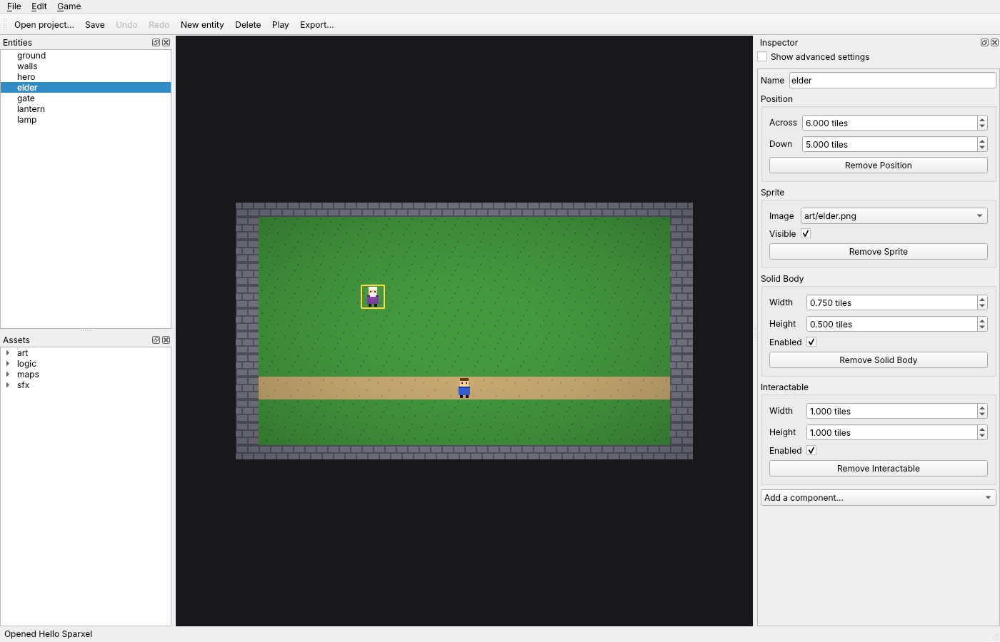

# The editor

> **Status: v0.1.** `sparxel-editor` opens a project folder, draws its scene as the game
> draws it, lists its entities and assets, and edits every component through an inspector
> generated from the reflection registry, paints maps, places pictures, and edits logic as
> plain language. It has undo and redo, saving, Play and Export.
> It is built on Qt 6 Widgets (ADR-005), and tested on Qt's offscreen platform in CI on
> Windows and Linux.
>
> Code: [`editor/core/`](../../editor/core/) (the model, without Qt),
> [`editor/app/`](../../editor/app/) (the Qt application) and
> [`editor/exporter/`](../../editor/exporter/) ([export.md](export.md)). Tests:
> [`tests/editor/`](../../tests/editor/) and [`tests/editor_app/`](../../tests/editor_app/).

## 1. What it is for

The editor is where a creator makes a game without writing code (`plan/06`). This first
version covers the loop every later tool plugs into: open a project, see the scene, select
something, change it, paint its maps, undo, save, play, export.



## 2. Using it

```sh
sparxel-editor samples/hello
```

| Part | What it does |
|---|---|
| **Scene** (middle) | The scene drawn by the engine, as the game draws it: the project's resolution, style, lighting and look, at the largest whole-number scale that fits. **Click** selects what is drawn on top (sprites before maps) and **drag** moves it, to whole pixels, as one undo step: in Classic 2D on the flat map; in the Diorama style through the 3D camera, picking the nearest billboard and dragging along the ground, so the ground under the cursor stays under it. Drag with the right or middle button, or use the arrow keys, to move the camera . **Move handles:** with a picture selected, a red arrow across and a green arrow down start at its position (in the Diorama style they lie along the ground, pointing the way the map's x and y go through the camera); dragging an arrow's head moves the selection along that axis only, as one undo step. **Turning and scaling** (in either style; in the Diorama style around the billboard as the camera shows it, turning in its own plane): a blue knob above the selected picture turns it about its position as it is dragged round (*Turn hero*; to 15 degrees at a time with snapping on), and a yellow square at its top-right corner scales it evenly as it is dragged away from or towards its position (*Scale hero*; to halves with snapping on, a flipped picture staying flipped); each drag is one undo step, and the Sprite's fields in the inspector do the same by number. With **several** pictures selected, the handles of the first turn and scale them as a group, about the middle of their positions: turning swings them round it and turns each picture as much; scaling spreads them from it (or draws them in) and scales each picture as much; positions go to the nearest picture pixel (*Turn 2 entities*, *Scale 2 entities*); with snapping on, the first lands on the 15 degrees or the half and the others change by as much. **The pivot** (Classic 2D): a white ring on the selected picture's position; dragged onto another point of the picture (to halves of it with snapping on), it moves the pivot there and the position with it, the picture staying where it is (*Move the pivot of hero*), so it turns and scales about that point, and draws in front of or behind others by it |
| **Entities** (left) | Every entity, children under their parents. Selecting one selects it everywhere. **Several** are selected with Ctrl or Shift, here or by Ctrl- or Shift-clicking in the scene (which also takes one out again), or by **dragging a box** in the scene from where nothing can be moved (the ground): a dashed box follows the cursor, and every picture it touches is selected: each is outlined in the scene; the inspector shows the components **all of them** have, each field with the first one's value (the one clicked last in the list) and its label marked *(differs)* where they disagree, and a change there goes to all of them as one undo step (refused, changing nothing, if any of them refuses the value); *Remove … from all* and *Add a component to all…* (listing what not all of them have) work on them all, and a name typed in *Name them all* names them after it, numbered (*tree_1*, *tree_2*, … skipping names others have, so logic can tell each apart), one undo step each; **dragging** any of them moves them all by the same amount as one undo step, and **Delete** removes them all as one step |
| **Assets** (left) | The project's `assets/` folder: pictures, sprites, sounds, scenes and logic. **Double-click a conversation** (`.dtalk`) to edit it in the Story window ([story.md](story.md)). **Double-click a picture or a sprite** to draw it in Sprite Studio ([sprite-studio.md](sprite-studio.md)); what is saved there shows in the scene at once. **Right-click a picture** for *Open in Sprite Studio* and *Make auto-tiles*: its 2 × 3-tile terrain blocks expanded into a tileset of every edge and corner (`<name>_auto.png`; [scene2d.md](scene2d.md), Auto-tiles). **Drag a picture into the scene** to place it where it is dropped (in either style): a new entity named after the file, with a Position at the nearest pixel and a Sprite showing the picture, selected, as one undo step. **Drag a sound into the scene** (WAV, Ogg, FLAC or MP3) to place a **Sound Source** there: the sound on repeat, louder the closer the player comes; its field in the inspector lists the project's sounds. **Drag another scene into the scene** to place a **door** to it there: an entity *door_to_road* (numbered if the name is taken) with a Trigger Area, and, in `logic/doors.drules` (made if missing), the Rule *When [who] walks in (door_to_road): Go to scene “maps/road.dscene”*, all as one undo step (*Place a door to road*), to change like any other Rule. **Doors both ways:** if the other scene has no door back here yet, one is made there in the same undo step: *door_to_village*, with a Trigger Area, where the player starts in that scene (its first Top-down Mover; else at the same point of its map), to be moved where it belongs when that scene is opened, and its own Rule, which comes here arriving at the new door. Each door's Rule then arrives at the other (*Go to scene “maps/road.dscene”, arriving at “door_to_village”*). The other scene's file changes when the project is saved, as this scene's does, and undo takes the door back away again (saving then puts the file back). If that scene already has a door back here (made by hand, say), no other is made: the new door's Rule arrives at it, and the door back's Rule, if it simply goes here, now arrives at the new door, in the same undo step. Arriving in a door's area is not walking into it ([game.md](game.md)), so the player is not sent straight back. The scene open here is refused. Other files, and files from outside `assets/`, are refused with a message |
| **Tiles** (left) | With a tilemap selected, its tileset's tiles and an eraser. Choosing one puts the scene in **paint mode** (in either style; in 3D the cell is where the cursor meets the ground): the left button paints the tile into the cell under the cursor, the right button erases, the middle button still moves the camera. Each stroke is one undo step; painting past the map's right or bottom edge grows it. The **Raise** and **Lower** brushes (on a second row) build Diorama terrain: each tile a stroke passes rises (or sinks) half a tile, at most 16, at least the ground, once a stroke; the right button does the opposite; a stroke is one undo step (*Raise ground*; `Document::raise_tile()`). Three painting **tools** sit above the tiles: the **Pencil** paints cell by cell along the stroke; the **Rectangle** is dragged out (a dashed outline shows it) and painted when the button comes up; the **Fill** paints the clicked cell and every cell of the same tile joined to it by its sides, inside the map as it is. Each rectangle and each fill is one undo step, and the right button erases with them too. **Random variants**: Ctrl+click more tiles to paint with several at once (each is outlined); the pencil, rectangle and fill then paint each cell with one of them at random, so grass, flowers and cobbles do not repeat; a pencil over a cell holding one of them leaves it (`Document::set_tile_variants()`), and a plain click goes back to one tile. The **Scatter** tool (beside Raise and Lower) paints only some of the 3 × 3 cells around the cursor as it passes, each cell once a stroke, at the **Density** chosen below the tools (25% by default): rocks and flowers sprinkled rather than laid in rows; the right button scatters holes. A stroke is one undo step. On a tilemap with **Auto-tile** on, the palette shows one tile per terrain, and painting picks each cell's edges and corners from its neighbours ([scene2d.md](scene2d.md), Auto-tiles). Choosing the tile again, Escape, or selecting something else stops painting |
| **Inspector** (right) | The selected entity's name, and a group for each component with a field for each property: a tick box for yes/no, number fields with the property's range, step and unit, a list for choices, and a list of the project's pictures for an image or tileset. Read-only properties are shown but cannot be changed; *Show advanced settings* adds the advanced ones. Each group can be removed, and *Add a component…* lists those the entity does not have |
| **Logic** (right, beside the inspector) | Every logic file of the project, its Rules, Sequences and Brains as plain language: *When [who] interacts with it (elder)*, then its steps (*Say “…” (dialogue)*, *Wait until not a message is open (dialogue)*, *If the answer chosen (dialogue) = 1:*), nested as they run. **Editing:** selecting a step shows the values written into it (the words said, the seconds waited, a property's new value) as fields of their kind, with their ranges and choices, and typing changes the line as you type. **Add** puts in, from lists built from the registry and the scene: a **step** (Log, Wait, Repeat, Run a Sequence, **If** or **Wait until** a condition picked from the list, or any action of the game's objects and the scene's entities, by object) after the selected step, first inside a selected If or Repeat, or first under a selected Rule, Sequence or state; a **condition** on the selected Rule or "Go to"; a **Rule** on any event (the game starting, or an object's); a **Sequence**, a **Brain** (with a first state, *idle*), a **state**, a **"Go to"** out of the selected state, or a **new logic file**. Names, a "Go to"'s target and time, and the Sequence a Run step runs are values too; renaming a state or a Sequence renames what refers to it. **Delete** removes any block; **Up** and **Down** move steps, and a step can be **dragged** onto another line to go where a step added there would (after a step, inside an If or Repeat, first under a Rule, Sequence or state; never into itself). **Not** turns the selected condition (or an If's or Wait until's test) into its opposite; a Rule's tick box makes it run when **any** of its conditions holds rather than all, shown as *If any of these:* with each condition on its own line. **Group** puts the selected condition and the one after it into a group of their own, matched the other way from the list they are in (*Any of these:* among conditions that must all hold, *All of these:* inside *any of these*), so groups go inside groups to any depth (*any of: a message is open, or all of: slot 1 and slot 3 have a save*); a selected group has its own tick box for any or all, takes conditions added while it (or one of its conditions) is selected, and **Split** puts its conditions back in its place. Deleting a group's condition down to one leaves that one in the group's place. Conditions and whole groups are **dragged** too: onto a condition to go after it, onto a group or a Rule to go first in it. Steps go into an **Otherwise** from the Add menu's Otherwise list, or by adding while an *Otherwise:* line is selected. **Variables:** each file's are listed under the tree with their name, the value they start with and Delete (refused while a block uses them); Add ▸ Variable makes one (a whole number, a number, yes/no or text), Add ▸ Compare tests one, or a value the Rule's event carries, or a property (*talks ≥ 2*, *[answer] = 1*, *speed of hero > 4*: a condition on a selected Rule or "Go to", else a new If step), and the built-in *Set [variable] to [value]* step changes it. Renaming a variable renames every block that uses it. **Where a value comes from:** each value's **From…** button writes it, or takes it from one of the file's variables, a value the Rule's event carries (*[answer]*), a property of an object or entity (*speed of hero*), or a value an object gives (*the answer chosen (dialogue)*, *the number of “coin” (inventory)*), offering only those of the value's kind (the *Compare* menu offers the same); what such a value needs filled in (the thing's name) gets fields of its own beside it, starting from their defaults and edited in place, the value reading as it is typed, and each its own **…** button, which writes it again or takes it from a variable, an event value or a property of its kind (*the number of name_wanted (inventory)*; not from another object's value); numbers can then add, take away, multiply or divide by a written number (*talks + 1*), which stays editable in place, or by another value (*Sum with*: *talks × [answer]*); **Then** adds one more part after a sum, a number to begin with that can in turn come from elsewhere, so sums grow to any length (*(talks × [answer] + 3) × talks*). **In brackets** makes the last part a bracket of its own with one more part in it (*talks × (a + 1)*); until it is taken away, the field, *Sum with*, the sign and *Without the last part* work on the bracket's own last part (a bracket can hold another), with everything before it shown beside the field (*talks × (a +*), and *Then* still adds after it all. Parts work in order, each on the result so far, and the line puts brackets where the order would otherwise read differently; *Without the last part* takes one away. Below, the compiler says whether the file runs, or its first problem; each problem also marks its own line in red, with what is wrong as the line's tooltip. Logic edits are steps of the same Undo as the scene's, and Save writes the files that changed, and removes, with their `.meta`, files that were made here and then undone away |
| **Project** (right, beside the logic) | The project's settings as fields, grouped as a creator thinks of them: the game (name, gravity, the fade between scenes), the picture (style, size, pixels per tile, background), the Diorama camera, light and shadows (ambient light, sunlight, the sun's direction and height, sprite and block shadows), the **style guide** (`plan/02` A11: a **palette** of `#rrggbb` colours the art keeps to, shown as swatches, typed, taken **From a picture…** of the project, or set to **Sprite Studio's** 32; new sprites start with it, and *Check the project* adds a note for each picture with colours outside it, naming up to four; and the game's **Font**, a picture of letters, with **Its letters** in order: [ui.md](ui.md) §2), and the Look (tilt-shift, blur, bloom, grading, vignette), headed by a gallery of **Look presets** (*Plain*, *HD-2D*, *Dreamy*, *Moonlit*, *Sunset*, *Crisp retro*, *Noir*; `editor/core/looks.h`): hovering one shows it in the scene without changing anything, leaving puts the project's own back, and clicking one takes it, as one undo step. Changes show in the scene as you make them; values the game would refuse are refused with its message; each change is an undo step, and Save writes the project file |
| **Commands** | **New project** (Ctrl+N: asks for the game's name, what to start from, and an empty folder. **Classic 2D** or a **Diorama** (the same game in 3D, lit by the sun, with shadows and tilt-shift) make a small game: a field of grass crossed by a path, stone walls that stop the hero, and a hero moved with the arrow keys, with the tileset and the hero's picture as ordinary files in `assets/art` to draw over. A **Platformer** makes a level seen from the side, under a sky: grass over stone, walls at both ends, three ledges rising to the right, the hero, who walks left and right and jumps 3 tiles with Space or Up ([game.md](game.md), Jumping), and a gold coin on each ledge; `logic/coins.drules` gives the player a coin for each one walked into (the [inventory](game.md#the-inventory)), hiding it and switching its area off, and says *You found all the coins!* with all three. A **Visual novel** makes a story: a backdrop filling the screen (sky, hills and a meadow), a character, Mira, and `logic/story.drules`, in which she greets the player, asks whether they will walk with her, and answers whichever they pick, all of it to change in the Logic view. An **RPG** makes the Classic 2D village with the RPG kit working together: a title screen (with credits) and pause menu, an elder whose conversation asks the player to deal with a slime (and gives a potion and starts a quest on *Yes*), a shopkeeper selling potions and a bronze sword ([shop.md](shop.md)), a slime on the road that starts a battle when walked into and is gone once beaten ([battle.md](battle.md)), the tables behind them (`data/party` with growth and a skill learned at level 2, `data/enemies`, `data/skills`, `data/items` with prices and the sword as a weapon), `logic/village.drules` connecting it all, and the gold, on a framed panel, and the hero's HP on screen), **New conversation** (asks for a name; makes `talk/<name>.dtalk` and opens it in the Story window: [story.md](story.md)), **New sprite** (Ctrl+Shift+N: a name and a size; makes `art/<name>.dsprite` and its sprite sheet and opens them in Sprite Studio), **New scene** (asks for a name; makes an empty `maps/<name>.dscene` and opens it), **Start the game in this scene**, Open, Save (Ctrl+S), Undo and Redo (with what they will undo, for example *Undo Change Speed of hero*), New entity (where the camera looks), Delete, **Cut, Copy and Paste** (Ctrl+X, C, V: the selected entities with everything under them, kept on the clipboard as a scene document so they paste into another scene or project; pasted where the camera looks, each with a new GUID and a name no other entity has, *hero_2*, as one undo step), **Duplicate** (Ctrl+D: copies a tile right and down, under the same parent, selected), **Select all** (Ctrl+A), **Frame the selection** (F, in the scene: the camera to the middle of what is selected), **Put under ▸** another entity and **Put at the top** (right-click in the Entities list), **Snap to tiles** (dragged things land on the grid: the one grabbed, with any others selected moving by as much), **Snap grid** (*Whole tiles*, *Half tiles* or *Quarter tiles*), **Play** (F5: saves, then starts `sparxel-player` on the project) and **Export** (saves, asks for an empty folder, then exports: [export.md](export.md)) |
| **Help ▸ Sparxel guide** | F1: every page of this guide (`docs/dev`), built into the editor so it works offline: a search over all pages (each word, titles first) beside the page, shown with its pictures; links to other pages open them in the window. Ctrl+K search finds the pages too (*Guide ▸ Shops*) |
| **Tutorials** (right, beside Project; Help ▸ Tutorials) | Step-by-step lessons inside the editor (`plan/02` Q1): *Your first game* (open a project, select the hero, make it faster, paint the ground, save, play) and *Make someone talk* (write a conversation, start it from a Rule, play). Each step says how in a sentence; the panel ticks it off (✓) when it sees it done in the editor, checking twice a second, never because a button was pressed. **Show me** points at the panel the step needs with a bright frame for a moment; **Skip** goes on without doing it |

**Project Doctor** (the *Doctor* panel beside *Project*, or **Game ▸ Check the project**,
F7): checks the whole project for what would go wrong in the game and lists it in plain
language, **problems** first, then **warnings**, then **notes**, the kind written as well as
coloured. It finds a start scene that is not a scene; in every scene (the open one as it is
now, the others as saved), any component whose picture, tileset or sound is no longer in
`assets/` (a problem naming the entity; double-clicking opens its scene and selects it);
logic the compiler refuses, on its block (double-clicking shows the file in the Logic
view); scenes that nothing leads to: not the start, and no logic or door goes there (a
warning); and pictures and sounds no scene or logic uses (a note: they still go into
exported games). The status bar sums it up (*Doctor: 1 problem(s), 0 warning(s), 2
note(s)*). (`editor::examine()` in [`doctor.h`](../../editor/core/include/editor/core/doctor.h),
without Qt.)

**Prefabs** (`plan/02` C3): **Edit ▸ Make a prefab…** saves the selected entity, with
what is under it, as `assets/prefabs/<name>.dprefab` (its place left at 0, 0) and links the
entity to it (a *Prefab* component). **Drag a prefab from the Assets into the scene** to
place a copy where it is dropped: its entities with new GUIDs, the copy linked to the
prefab, one undo step (*Place villager*). **Edit ▸ Update copies of this prefab** (with a copy
selected) makes every copy in the scene match the prefab file again, each keeping its own
name, place and GUID, as one undo step (*Update 3 copies of villager*); what was changed on
a copy is replaced. (`Document::make_prefab()`, `place_prefab()`, `update_prefab_copies()`;
`serialize::subtree_to_json()` and `with_new_guids()`.)

**Search everything** (Ctrl+K, in the Edit menu): one box that finds, as you type, every
command of the menus that can run now (by its menu: *Game ▸ Play*, with its shortcut), the
project's scenes (opened), pictures and sprites (opened in Sprite Studio) and logic files
(shown in the Logic view), and the scene's named entities (selected), as the command
palettes of code editors and other engines do. Its letters match in order, not only side by
side (*vlg* finds *village*), best first: matches at the start of the name and of its words,
letters together, and shorter names come first. Up and Down choose, Enter runs.

**The start page.** With no project open (at first, or after **File ▸ Close project**,
Ctrl+Shift+W, which asks to save first), the editor shows what to do, as other engines'
project managers do: **New project…** and **Open project…** (the File menu's commands),
**Try the sample village** (the sample packaged beside the editor), and the **recent
projects**, the latest first, by their game's name and folder: double-click one (or press
Enter) to open it; right-click to leave one off the list. A project whose folder or project
file is gone shows as *missing*. The ten latest are kept in the user's settings.

**Panels** can be dragged anywhere around the scene: beside or under one another (split
as finely as wanted), together as tabs (tabs on top), or out as floating windows; a group
of tabs drags as one by its title. **The layout** (where each panel is, split, tabbed,
floating or closed, and the window's size) is kept between sessions in the user's settings (`QSettings`: the registry on Windows).
The **View** menu lists every panel, so a closed one can be opened again, and *Reset
layout* puts them all back where they were at first.

The title shows the game, the scene being edited, and a star while there are unsaved
changes; closing asks whether to save them.

**Never losing work** (`plan/06` §5). Every minute, and whenever the editor stops being the
window in front, unsaved work (the scene, the logic, the project's settings, and other
scenes changed here) is kept in the project's recovery file, `.sparxel/recovery.json`,
written atomically beside `assets/` (hidden from the asset list, and never exported); the
project's own files are not touched. If the editor closes without saving (a crash, a power
cut), opening the project again says so and how long ago the work was kept, and offers it
back: restoring opens the scene it was made in and puts the work back as one undo step,
*Restore unsaved work*, to save or undo. Saving removes the file, and so does choosing not
to save when closing. (`Document::write_recovery()`, `restore_recovery()`,
`discard_recovery()`, `recovery_scene()`; Sprite Studio's sprites are not kept yet.)

**The Assets panel** (`plan/02` A4). Pictures show as small thumbnails of themselves
(scaled by whole pixels, so pixel art stays sharp, and remade when the file changes). The
**search box** over the panel lists only names with every word typed, in order (*ro sc*
finds `road.dscene`), opening folders to show what matched. **Right-click any asset** for:

- **Find usages**: the files that use it, with the entities using it in each scene or
  prefab (*maps/village.dscene: hero*). Pictures and sounds are found by their GUID,
  scenes, conversations, tables and logic by their path; the project's settings count too
  (the start scene). Double-click a scene, conversation or table there to open it.
- **Rename…**: a new name in the same folder. The asset moves with its `.meta` (so its
  GUID, and everything that uses it by GUID, stay the same) and its companions: a
  picture's sprite sheet (`.sheet`), Sprite Studio source (`.dsprite`) and Aseprite file
  of the same name. Every reference by path, in scenes, logic, conversations, prefabs,
  tables and the project's settings, is rewritten (a table's both with and without
  `.dtable`). The project is saved first and opened again after, in the same scene (by its
  new name if it was the one renamed). A taken name is refused, and so are the tables the
  game reads by name (`data/party`, `data/enemies`, `data/items`, `data/skills`,
  `data/levels`, `data/states`, `data/achievements` and `data/translations`).
  A rename cannot be undone with Undo; take a snapshot first for a big one.

(`editor/core/asset_tools.h`: `find_asset_usages`, `asset_group`, `rename_asset`;
`editor/app/src/asset_browser.h`: `AssetThumbnails`, `asset_filters`.)

**Recolouring a sprite** (a palette swap). A Sprite's *Recolour* field has a
**Recolour…** button that shows every colour of its picture beside the colour it will be
drawn as, and the picture before and after. **Shift every colour** turns them all round the
colour wheel at once, keeping how light each is (greys stay grey); clicking a colour picks
another for it alone; **As it is** starts again. OK keeps only the colours that change, as
one undo step; the picture's file is not touched, so one slime picture can be a green slime
and a red one ([scene2d.md](scene2d.md), Palette swaps).

**Snapshots** (`plan/02` A7). Before trying something big, *File ▸ Take a snapshot…* keeps
the whole project, saved first, as a named restore point with a picture of the scene, in
`.sparxel/snapshots/<date and time> <name>/` (never exported). *File ▸ Snapshots…* lists them,
the newest first, with their pictures: **Go back to it** puts the project back as it was
then and opens it again, after keeping the project as it is now as one more snapshot,
*Before restoring*, so going back can itself be undone; **Delete** removes one for good. A
snapshot is a full copy, so it needs no version control and works offline; for a project's
history over months, a Git repository is still the better tool.
(`editor/core/snapshots.h`: `take_snapshot`, `list_snapshots`, `restore_snapshot`,
`delete_snapshot`.)

**Scenes.** A project opens in the scene its game starts in. **Double-click a scene** in
the Assets to edit it instead; the open scene is saved first if it changed, and Undo
starts again in the scene opened. Logic belongs to the whole game: a Rule can be about an
entity of any scene, and is checked and read the same whichever scene is open. To move
between scenes in the game, logic uses the Game object's *Go to scene …* steps, and Rules
on *When a scene starts* run on arriving ([game.md](game.md) §8).

## 3. How it works

- **`editor::Document`** (in `editor/core`, no Qt) holds the open project: its settings,
  asset database, a registry of every type the game uses (`game::register_types`), and a
  world with the start scene loaded. Every edit goes through it.
- **Undo by snapshots.** Each edit records the scene before and after, as the JSON the
  scene file holds; undo loads the earlier one. This is correct for every kind of edit
  without one command class per kind. Entities are found again by GUID, which survives a
  reload, so selection survives undo. Consecutive changes to one property of one entity
  (typing, spinning a number, dragging) **merge** into a single step until the field
  loses focus or the drag ends. Scenes are small enough that copying them per edit costs
  nothing noticeable; large scenes will need commands that record only what changed.
- **The inspector knows no component.** It reads each component's `TypeInfo`: display
  names, tooltips, kinds, ranges, steps, units, choices and flags. A component registered
  tomorrow gets its fields with no editor change.
- **`editor::Preview`** draws a Document on a headless GPU device and returns pixels:
  the same `draw_world` / `draw_diorama` and `PostProcessor` the game uses, so what the
  editor shows is what the game shows. The scene view puts those pixels on screen.
- **Logic as language** (`editor::describe`): each Rule, Sequence and Brain becomes
  lines built from the blocks' own reflected texts (`block_text`): an action's text with
  its values filled in, a property's display name, events with their values in brackets,
  and operators as symbols. Members are found on the game's objects by name, and on
  entities through their components, so a new component's blocks read well with no
  editor change. Every line keeps its block id, for highlighting and explaining later.
- **Editing logic** (`Document::logic_slots()`, `set_logic_slot()`, `add_logic_step()`,
  `remove_logic_step()`, `move_logic_step()`): the Document holds the logic files, and
  its undo snapshots hold them beside the scene, so one Undo history covers both and
  Save writes each file that changed. A value's kind, range and choices come from the
  block's reflected parameter or property, and a value that does not fit is refused in
  plain language; typing into one value merges into one step. A new step's values start
  at the parameters' defaults, and it gets a block id no block of the file uses.
  `check_logic()` runs the real compiler against the registry and the scene (the game's
  objects by name, entities through their components, as the game resolves them), so
  renaming an entity a Rule names shows at once.
- **Project settings** (`Document::set_settings()`) go through `project_to_json()` and
  `project_from_json()`, the same check the game runs on its project file, so the editor
  can never save settings the game would refuse. The snapshots behind undo hold them
  beside the scene and the logic; Save writes the project file only when they changed.
- **Picking in 3D** (`editor::pick_diorama`) projects each billboard's corners through the
  game's camera (`diorama_camera()`, which the preview uses too, so they always agree) and
  takes the nearest that covers the point; else the map where the ray from the eye
  (`scene2d::diorama_ray()`) meets the ground (`scene2d::ground_hit()`).
- **Picking** (`editor::pick`) finds the entity drawn on top at a map point in Classic 2D,
  in the draw order the game uses (layer, then y, then GUID): a sprite whose picture
  covers the point (turned and scaled as drawn, with `scene2d::sprite_corners()`; a turned
  picture is outlined by the box around it), else a tilemap with a tile there.
- **Qt stays in the editor** (ADR-005). The engine and exported games never link it. Qt's
  `emit`, `signals` and `slots` keywords are turned off (`QT_NO_KEYWORDS`), because they
  clash with the engine's own names; the editor uses `Q_EMIT` and `Q_SIGNALS`.
- **Building.** With Qt 6.4 or later found by CMake, the editor is built; without it,
  everything else still builds and a message says the editor was skipped. CI sets
  `SPARXEL_REQUIRE_EDITOR=ON`, so a missing Qt fails the build instead. Linux CI uses
  Ubuntu's Qt 6.4; Windows CI installs Qt 6.8.3 for MSVC with `aqtinstall`
  ([building.md](building.md)).

## 4. Tests

| Test | Checks |
|---|---|
| Opening | The sample's settings, scene and its 7 entities in order; component types sorted by name, behaviours included; a missing project refused |
| Properties | An edit changes the world and marks the scene changed, labelled *Change Speed of hero*; typing three values is one undo step back to the original; after a field loses focus the next change is its own step; a new edit clears redo; a value of the wrong kind and a component the entity lacks are refused, with nothing changed |
| Painting | A stroke over three cells is one undo step; painting past the right edge grows the map, with empty cells between; cells above or left of its corner, and entities without a tilemap, are refused; erasing; a new stroke after `end_merge()` is its own step |
| Several entities | `set_property_many()`: *Across* typed for the hero and the elder sets both, the typing one step (*Change Across of 2 entities*), undone together; a lantern without a Sprite and a radius out of range are refused with their messages, changing nothing and recording nothing; two lights' radius set together; one entity reads *Change Across of hero*; `add_component_many()` adds a Sprite to the two lights and not to the hero who has one (*Add Sprite to 2 entities*), refuses when all have it, `remove_component_many()` removes it from all three (*Remove Sprite from 3 entities*), refuses when none has it, and both undo exactly; `rename_many()` names the hero and the elder *tree_2* and *tree_3* past another entity's *tree_1* (*Rename 2 entities*), refuses an empty name, undoes together, and does not count their own names as taken. `move_entities()`: a group dragged three times is one step (*Move 2 entities*), a second drag another; an entity without a Position and a point that is not a number are passed over, and nothing moved is false; `delete_entities()`: one step (*Delete 2 entities*) passing over a GUID that is not there, false when none is, undone together; one alone reads *Delete elder* |
| Entities and components | Create, add a component (twice refused), rename, delete and undo (same GUID and components back), remove a component and undo; a drag of five moves is one step; undoing everything returns to the scene as opened |
| Picking in 3D | Through the sample's Diorama camera: the hero's billboard rectangle lies below the middle of the screen; its middle picks the hero, beside it the ground; the elder; the wall along the bottom edge; nothing in the sky |
| Logic as language | The sample's logic file found and read in full, line for line (its three Rules with their steps, the If and Otherwise, and the weather Brain's states, steps and timed transitions); every line traced to a block; conditions, all-of, not, waits, repeats, runs, Otherwise, event values and an unknown object read sensibly |
| Placing assets | `place_asset()`: the hero's picture at (3.03, 4.94) becomes an entity "hero" at (3, 79/16) with a Sprite showing it, labelled *Place hero*, undone in one step; a logic file, a missing picture and a point that is not a number are refused with messages, recording nothing; a sound becomes an entity "chime" with a Sound Source repeating it (volume 1, range 8, playing) and no Sprite, which saves and reopens as placed |
| Editing logic | The elder's greeting: one value, its text, changed in place (two edits typed, one step); a number is refused for it. A Brain state's ambient light: its range from the registry refuses 3, takes 1. The actions offered, sorted by object. A chime added after the greeting with its default value, compiling; moved up; the first step not moved higher; deleted. A step under a Rule's header goes first; under a Brain, refused; an unknown object refused. Renaming the elder makes the compiler report its Rule; undoing everything returns the logic exactly; redo; saving writes the file and reopening reads the edit |
| Authoring logic | A new file (badly named, existing and escaping ones refused), compiling empty; a Rule on the elder's event from `logic_events()` (an unknown event refused); a condition from `logic_conditions()` (an action refused); steps, including Run and Wait; two Sequences, a Brain with a second state and a "Go to", reading line for line as expected and compiling; renaming the state moves the "Go to"; its time changed; a missing target, a taken name and a bad name refused; Run's Sequence checked, and renaming the Sequence renames the Run; deleting a condition, a "Go to", a state, the Brain, a Sequence and the Rule; undoing everything removes the file, redo brings it back; saving writes it with its `.meta`, and reopening reads it |
| Project settings | Two changes before the merge ends are one step (*Change the project settings*), with the start scene kept; pixels per tile 3 refused with the game's message, changing nothing; undo restores every setting and the project is clean again; redo, save, reopen reads them |
| Logic branches and loops | A Rule on the game starting with an If (slot 3 has a save: its slot a value, changed in place), a Wait until inside it and a Wait after that, and a Repeat 5 times with a Log inside, reading line for line as expected and compiling; an action refused as an If's condition |
| Not, any and Otherwise | A condition turned around (*not*), a second and a third joining an *any of these* group (the third's value edited in place), steps, an Otherwise for the Rule and for an If (whose test is turned around too), line for line and compiling; Otherwise refused on a condition; deleting down to one condition, and back to *all*, splits or dissolves the group; *any* refused with one condition. (This test found that the group's id was taken after its conditions were moved out of the Rule, duplicating one; fixed.) |
| Groups inside groups | Three conditions on a Rule; the last refused for grouping (nothing after it); the first two grouped as *any of these* (one undo step, the Rule itself still *all*), which Not leaves alone; its only two refused for grouping again; a condition added with one of the group's selected joins the group; two of its three grouped as *all of these* inside it, line for line and in the asset's own structure, compiling; a condition deep inside turned around and its value edited; the inner group flipped to *any* and back; deleting one of its two leaves the other in its place; a condition refused for splitting; splitting the inner then the outer gives the four conditions in order, compiling; undo brings both groups back; with one group left on the Rule, the Rule reads as *any*, the group's switch and the Rule's flip it, compiling |
| Moving conditions | A step refused as a condition, a step refused as a place, and a group refused inside itself; a condition onto a group (first in it) and onto a condition (after it), line for line and compiling; onto its own group and onto a Rule that matches any (first); a whole group moved after a condition; the group's last-but-one condition moved out dissolves the group; undo brings it back |
| Variables | Setting one refused before any exists; a whole number and a text made with free names, a choice refused; a start of the wrong kind refused; a Set step whose value is changed, then its variable (the value starting again from that kind's zero), a missing one refused; a comparison as the Rule's condition (≥ 2) and one as an If (≠), a bad operator refused; renaming follows into every block; a taken name refused; deleting refused while used, the unused one deleted; compiling throughout |
| Values from elsewhere | A Set step on *When an answer is picked* takes the answer (*Set talks to [answer]*; the slot reads where it comes from), then talks plus a number (the number written and edited: *talks + 2*), times instead, times the answer (*talks × [answer]*, the slot reading it all); longer sums: one more part after that (+ a written 1, edited to 3, the slot reading *talks × [answer] +*), then × talks, read as *(talks × [answer] + 3) × talks* and built in that order in the asset, compiling, and the last part taken away twice; back to a written number; in brackets, *talks × (1 + 1)*, the field (beside *talks × (1 +*) setting *talks × (1 + 5)*, the answer and minus inside it (*talks × (1 − [answer])*), a bracket in the bracket (*talks × (1 − [answer] × 1)*, beside *talks × (1 − [answer] ×*), the brackets on the right in the asset, compiling, and taken away one at a time; then no sum; writing a value makes it written again, and a sum or one more part on a written value is refused; a Wait takes the hero's speed (*Wait speed of hero seconds*); the answer compared (*If [answer] = 1*) and the hero's speed (*If speed of hero > 4:*, its value a number), a made-up property refused; only sources of the value's kind are offered, a made-up one refused, and event values only inside a Rule whose event has them; compiling throughout |
| Moving steps | A Log moved into a Repeat (dropped on it: first inside) and a Wait out to first under the Rule, line for line, one undo step each; a Repeat into its own Log, a Rule, and an unknown place refused; undone back to the start |
| Rectangles and fills | A 3 by 2 rectangle between two points in either order, its neighbours untouched; two rectangles are two steps; one past the right edge grows the map and leaves out the part left of its corner; one wholly outside is refused; erasing never grows the map; a fill inside a ring of path stays inside it (nine cells), changes nothing when it is so already, is refused outside the map and on what is not a tilemap, and erases; undo returns the map exactly |
| A new project | An empty name refused, making nothing; the project file, both pictures, the start scene and every `.meta` written; a folder with something in it refused; it opens with no notes: the name, the start scene, three entities, the hero at (10, 6) with a Top-down Mover, a 20 by 12 ground of grass crossed by a path, a solid ring of stone, and the tileset found by its GUID as a 48 × 16 picture; painting and saving work, and reopening finds the edit. Drawn (GPU): the wall's stone, the grass, the path, and the hero's tunic and face at exact pixels. Played in the game's own runtime with recorded input: the hero walks 4 tiles in a second, stops against the east wall and stays there, with no logic errors. The Diorama template opens in the Diorama style and draws differently from the flat one, the grass filling the middle of the picture. The visual novel: its story's `.meta` written; it opens with no notes, the backdrop and Mira listed; drawn (GPU) looking at the origin, the sky reaches the top-left corner and the meadow the bottom-right one, and Mira's dress and face are at exact pixels right of the middle; played twice in the game's own runtime, with no notes: Mira's greeting shows first, then her question with its two answers, and after the first answer she replies *Wonderful!…*, after the second *Another time…*. The platformer: it opens with no notes, five entities, the hero with Jumping and a hitbox 1 tile tall, and three coins, each with a picture and a Trigger Area; `logic/coins.drules` checks and reads *When [who] walks in (coin_1)*, *Give 1 “coin” (inventory)*, *Set visible of coin_1 to no*, *Set enabled of coin_1 to no*, *If the player has at least 3 “coin” (inventory):*, *Say “You found all the coins!” (dialogue)*; drawn (GPU), the sky, the grass and the stone under it, the first ledge, the west wall, the hero's tunic and the first coin's gold at exact pixels; played with recorded input (Right held for a second, Space pressed after a third of it), the hero stands on the grass, jumps higher than 2.8 tiles, lands on the first ledge (y = 8) and walks along it to x = 8, on the ground, picking up the first coin on the way (one carried, that coin hidden and its area off, the second still there); with the other two coins moved onto the first and played the same way, all three are picked up and the message shows, once |
| Scenes | The sample has one scene; a new one refused without a scene's name, outside `assets/`, over an existing file and while changes are unsaved; made, it is open, empty and clean, with its file and `.meta`, and Undo starts again; a bat made in it with an Interactable gets a Rule that checks, as the elder's Rules still do though the elder is in the other scene (`types_elsewhere()`); leaving with unsaved changes is refused; after saving, the village opens as it was and the bat's Rule still checks and reads the same; a missing scene and a picture are refused; *When a scene starts* is offered and its Rule takes *Go to scene “maps/cave.dscene”, arriving at “bat” (game)*; the start scene is set as one undo step, refused for a missing scene, saved, and the project reopens in it |
| Saving | The scene file is written; reopening finds the edit; saving keeps the history |
| Doors | The road placed in the village where the hero stands: *door_to_road*, a Trigger Area at the nearest pixel, and, as the road has no door back, *door_to_village* made there, so that a new `logic/doors.drules` reads *When [who] walks in (door_to_road)*, *Go to scene “maps/road.dscene”, arriving at “door_to_village” (game)*, *When [who] walks in (door_to_village)* and *Go to scene “maps/village.dscene”, arriving at “door_to_road” (game)*, which check, as *Place a door to road*, the road's file unchanged until saved; a second door is *door_to_road_2*, arriving at the same door back, its Rule in the same file; the village itself, a missing scene and a NaN place refused, changing nothing; one undo takes the second door and its Rule, another the first, the door back and the file; saved, the road's file has *door_to_village* with a Trigger Area where the road's hero starts (3, 9); undone and saved, the road's file has it no more; redone and saved, it does; the road opened, the door back is there, its Rule checks, and it is moved to (2, 3) and saved; played in the game's own runtime, the hero standing in the village's door goes to the road, arrives at the door back (2, 3), and is still there two seconds later. A door back made by hand in the road (a Trigger Area and a Rule that simply goes to the village): a door to the road placed in the village makes no other, the two Rules arrive at each other, checking, and the road's file is left byte for byte as it was. An entity made, then a door, saved: undoing both and saving puts the road's file back without the door back and removes `logic/doors.drules` and its `.meta`, leaving nothing unsaved; redoing both and saving brings them back |
| Moving the pivot | The hero's pivot moved to the middle of its picture (two calls merged into *Move the pivot of hero*): its position goes to (10, 8.5) and the picture stays at (9.5, 8) to (10.5, 9); turned a quarter about its middle it covers the same place; turned, the pivot moved again (2 and -1 kept to 1 and 0) still leaves it there; NaN and the ground (no Sprite) refused; three undos back to the start |
| The inventory in logic | Its *give* and *take* actions and *has* and *has at least* conditions are offered; a Rule gives a key and, if the player has at least 3 coins, takes them, reading *Give 1 “key” (inventory)* and *If the player has at least 3 “coin” (inventory):* (the values where the block's text names them, not in the order of the parameters); a variable set to *the number of different things carried (inventory)*, which has nothing to fill in; another set to *the number of* a thing, its name a field inside the value (*Item*, text), typed as *co* then *coin* in one undo step, a number refused for it and a field it does not have refused, reading *Set variable_1 to the number of “coin” (inventory)*; *the answer's text (dialogue)* compared on the Rule; compiling. Filled in from elsewhere: the number of a thing whose name is offered as written or from a text variable, event value or property (never a whole-number variable, nor another object's value), taken from a text variable (*Change where Item comes from*), reading *Set variable_1 to the number of variable_2 (inventory)* and compiling; then not typed in place (refused, saying where it comes from), a source not offered refused, written again (starting empty) and typed; undone step by step |
| Turning and scaling | `turn_sprite()` keeps angles between -180 and 180 (270 is -90, -540 is 180, 720 is 0, never -0), and a drag's turns merge into one *Turn hero* step; `scale_sprite()` sets both scales at once within -16 to 16, as *Scale hero*; numbers that are not finite and entities without a Sprite are refused; one undo each for the scaling and for all the turning. A group with `shape_sprites()`: positions, angles (200 is -160) and scales (40 kept to 16) at once, merged while dragged as *Turn 2 entities* and *Scale 2 entities*; one without a Sprite or with NaN refuses them all, changing nothing, as does none; two undos put everything back |
| Picking | The hero's exact picture bounds; the hero, the elder, the ground and the walls (drawn after the ground) at points, and nothing outside the map. Turned a quarter, the hero lies to the right of its feet (10 to 11 across, 8.5 to 9.5 down) and is picked there, not where it stood; at 45 degrees its middle is picked and a corner of the box around it is not; flipped and twice as wide, it reaches from 9 to 11 |
| Preview (GPU) | The sample drawn at 320 × 180 with the hero's robe and the wall's stone at exact pixels, and the hero moved 2 tiles after an edit |
| The application | Opening the sample: title, list and a 320 × 180 scene. Selecting in the list fills the inspector; a number field edits the world; undo puts it and the field back; renaming in the inspector renames in the list; field labels are never squeezed out of sight. Clicking the hero in the scene selects it; dragging moves it 2 tiles right and 1 down to the nearest pixel, as one undo step; clicking the ground selects it; dragged by its arrow across two tiles across and one down, the hero moves two across only, and by its arrow down three back and one down, one down only, each one undo step; with snapping on, its turning knob (above the picture) dragged a quarter of the way round its feet turns it exactly 90 degrees (*Turn hero*), and its scaling square dragged twice as far from its feet doubles it both ways (*Scale hero*), each undone on its own; the pivot ring on the hero's feet, dragged to the middle of its picture with snapping on, moves the pivot to (0.5, 0.5) and the position to (10, 8.5) (*Move the pivot of hero*), undone. Painting: the ground's palette has its three tiles and an eraser; a left-button stroke paints a path four tiles long without changing the selection; a right-button click erases; each undoes on its own; the Rectangle tool paints 3 by 3 cells on release (nothing before) as one undo step; the Fill tool erases a joined area with the right button and fills it with stone with the left, leaving the grass around it, one undo step each; Escape and selecting something else stop painting. In the Diorama style: clicking the hero's billboard selects it; dragging it by its feet moves it along the ground to within a picture pixel of where the cursor points, as one undo step; its move handles start where it stands on the ground, the arrow across pointing the way the map's x goes on screen, and dragged by it two tiles across and two down it moves about two across and not down at all; its turning knob sits above the billboard and, dragged a quarter turn round its feet with snapping on, turns it 90 degrees, and its scaling square dragged twice as far doubles it, both undone; painting puts the tile in the cell under the cursor. A new entity gets a Light from *Add a component…*; saving writes it; deleting and exporting (which saves first) work; exporting over a project is refused. Dragging from the assets: the list's own drag data dropped on the scene (Qt's drag-enter and drop events) places the elder's picture at the map point under the drop, selected and listed, as one undo step; a sound dropped there becomes a Sound Source, selected, with the inspector's sound list (sounds only) showing it; the road scene dropped there becomes *door_to_road*, selected, with *logic/doors.drules* and its Rule and its door back's in the Logic view, gone again after one undo; a logic file and a file outside `assets/` are refused with a message in the status bar. The Logic view: selecting the elder's greeting shows its text in a field and "runs: no problems"; typing changes the line as you type, marks the project changed and is one undo step; Delete is enabled for steps only; Add step's menu adds a chime after the greeting, selected; Up moves it before; Delete removes it; Undo goes back through it all; renaming the elder shows the file does not run, and marks exactly the elder's Rule in red with *There is no object called 'elder'.* as its tooltip. The Project view: switching to the Diorama style redraws the scene in 3D and marks the project changed; the sun's direction follows its field; exposure 2 changes the picture; undo puts the numbers back (and their fields), then the style, and the scene is exactly as it was. Dragging: a Log line dropped on a Repeat line (drag-enter and drop events on the tree) goes inside it, stays selected, as one undo step; a loose condition dropped on an *If any of these:* line goes first in the group, still selected, as one undo step. Values from the view: a Set step's From… menu takes *the number of* a thing from the inventory, whose name field, typed *coin*, makes the line and the value beside it read *the number of “coin” (inventory)*; the **…** button beside the name takes it from a text variable (*the number of variable_2 (inventory)*, the field now the variable's name in words) and back to written (an empty field again); then the answer of *When an answer is picked* (the field becomes the words *[answer]*), then the variable plus a number, whose field sets it to *variable_1 + 3*, then plus the answer (*Sum with*) and back to a written 1, then (no *Then* menu before there is a sum) times a number from *Then*, whose field sets *(variable_1 + 1) × 4* with *(variable_1 + 1) ×* beside it, then *In brackets* plus a number (*(variable_1 + 1) × (4 + 1)*), whose field sets *(variable_1 + 1) × (4 + 2)* with *(variable_1 + 1) × (4 +* beside it, plus the answer inside the bracket, *Without the last part* back to *(variable_1 + 1) × 4*, and again back to *variable_1 + 1*, compiling; the Compare menu adds *If [answer] = 0* and *If speed of hero = 0* to the Rule. Variables from the view: one made from the menu, renamed in its field and given a start; compared on a Rule and set by a step; its Delete refused, with the reason in the status bar, while it is used. Not, any and Otherwise from the view: the Not button turns a condition around; with a Rule selected the tick box groups its two conditions under *If any of these:*; the Otherwise list adds a Wait to the Rule's Otherwise, and a Log added with the *Otherwise:* line selected joins it. Groups from the view: Group is disabled on a Rule and on the last condition; on the first of three it makes *If any of these:*, selected, with Split and its own tick box (ticked, worded for a group); a condition added with the group selected joins it; two of its three grouped make *All of these:* inside it, flipped to *Any of these:* with its tick box, compiling; Split puts its two back and selects the first of them. New project: over an existing project it is refused with the reason in the status bar and the open project stays; in a new folder it makes the starter game (the name trimmed), opens it, shows it in the title, lists its three entities and no logic, and draws it at 320 × 180; the Diorama starter opens in the Diorama style with tilt-shift on; the platformer opens with the level, the hero, who has Jumping, and three coins; the visual novel opens in Classic 2D with its two entities, the Logic view shows *logic/story.drules* with *When the game starts* and its five lines (Say, Ask, Wait until, If and Otherwise, each with its reply), and selecting the greeting says the file runs with no problems. Scenes from the window: New scene saves the open scene's change, opens the empty cave (in the title and the status bar, the list empty); the same name again is refused with why; a double-click on the village in the Assets opens it with the earlier change kept; the cave kept its entity; *Start the game in this scene* sets it as an undo step; a picture is refused as a scene. Several entities from the window: the hero clicked and the elder Ctrl-clicked are both selected, the hero first, both selected in the list; dragging the elder moves both by one tile across and one down as *Move 2 entities*, one undo step, after which both stay selected; with *Snap to tiles* on, the hero grabbed and dragged 1.3 tiles across and 0.6 down lands on (11, 10) and the elder, a quarter tile off its own, moves by the same tile and stays a quarter off; on the *Quarter tiles* grid (3 is refused as a grid), dragged 1.24 across and 0.76 down, the hero lands on (11.25, 9.75) and the elder moves by as much; with the elder turned to 30 degrees and both selected, the hero's knob dragged a quarter turn round the pair's middle (8, 7) with snapping on swings the hero from (10, 9) to (6, 9) and the elder from (6, 5) to (10, 5), turning the hero to 90 and the elder to 120 (*Turn 2 entities*, both still selected), and its square dragged twice as far from the middle doubles both and puts them at (4, 11) and (12, 3) (*Scale 2 entities*), each undone on its own; Ctrl-click takes the hero out and Shift-click puts it back, last; Delete removes both as one step; a plain click selects one alone; in the list, adding the lamp to the hero's selection selects both, the lamp first; a box dragged from the ground over the elder and the hero selects both, in the scene's order, moving nothing; the inspector then says *2 selected*, has no name field and no *Add a component*, shows the Sprite both have but not the hero's Top-down Mover, marks *Across (differs)* with the hero's 10, and setting 8 there moves both, as one step that undoes together, both still selected; *Name them all* with *pal* names them *pal_1* and *pal_2*, listed so, undone together; *Add a component to all…* offers no Sprite (both have one) and adds a Top-down Mover to the elder only (*Add Top-down Mover to elder*), *Remove Top-down Mover from all* removes both (*from 2 entities*), and two undos leave the hero's as it was; a box over no picture selects nothing; a click on the ground still selects the ground, and nothing is changed. The layout: panels may nest and drag in groups; the Assets panel split beside Entities lies to its right; Entities tabbed with the inspector moves to the right with it; the Tiles panel closed (its View menu entry unticked) and the layout saved to a settings file; a new window has it open until the layout is restored, then closed, with Entities back among the inspector's tabs; *Reset layout* opens it again; nothing saved, or a state that is not a layout, changes nothing. Authoring from the Add menu: a new file, a Rule on the game starting, a Wait step, an If (slot 1 has a save) and a Log that goes inside it, a Brain, a state renamed by typing, a "Go to" back to *idle*, "runs: no problems", and saving writes the file and its `.meta` |

## 5. The Windows package

Every build on GitHub makes **`Sparxel-windows`**: a folder that runs on a Windows PC
with nothing else installed. Download it from the build's page (Actions → the latest CI
run → Artifacts), unzip it, and open `sparxel-editor.exe`.

| In the folder | What |
|---|---|
| `sparxel-editor.exe`, `Qt6*.dll`, `platforms/` and other plugin folders | The editor and Qt's libraries, gathered by `windeployqt` |
| `player/` | `sparxel-player.exe` with only its own libraries and notices. The editor plays and exports with it, so exported games never carry Qt |
| `samples/hello` | The sample village, to open first |
| `README.txt`, `LICENSE.txt`, `THIRD_PARTY_NOTICES.md`, `QT-NOTICE.txt`, `qt-licences/` | How to start, and the licence notices: Qt is LGPL, linked dynamically, its libraries left as files that can be replaced |
| `vcruntime140.dll`, `msvcp140.dll` and the rest of Microsoft's C++ runtime, here and in `player/` | So it runs on a PC that never installed it (app-local deployment, taken from the Visual Studio that built it). Exported games copy the player's folder, so they carry it too |

[`tools/package_windows.cmake`](../../tools/package_windows.cmake) makes it from a build.
CI then **checks it with nothing else on the path** (no Qt, no build folder):
`sparxel-editor samples\hello --check` starts the editor, opens the sample and leaves
with 0 only if that worked (in this mode problems never open a dialog), and the packaged
player plays the sample for half a second.

**The installer.** Each build also makes **`Sparxel-windows-installer`**:
`Sparxel-Setup-0.0.1.exe`, the same folder wrapped by [Inno Setup](https://jrsoftware.org/isinfo.php)
6 (on GitHub's Windows image) from [`tools/sparxel.iss`](../../tools/sparxel.iss). It
shows the MIT licence, installs for the current user by default (no administrator
rights; into `%LOCALAPPDATA%\Programs\Sparxel`, where the sample stays editable), or
for everyone if chosen on its first page; adds Sparxel to the Start menu (and, if ticked,
the desktop); offers to open the editor on the sample when it finishes; and has an
uninstaller in Windows' installed apps. CI installs it silently into a temporary folder,
starts the installed editor on the sample (`--check`) and plays the sample with the
installed player, both with nothing else on the path, then uninstalls it and checks the
editor is gone. Its version, `AppVersion` in the script, follows the project's version in
`CMakeLists.txt`.

## 6. Next increments

1. **Logic, further:** lists as a kind of variable; and what a value needs filled in
   taken from another object's value too (*the number of the answer's text*), which needs
   fields inside fields. Today it is written, or comes from a variable, an event value or a
   property.
2. **The pivot ring in the Diorama style.** There a pivot's height also decides which point
   of the billboard stands on the ground, so moving it cannot leave the picture where it
   is, as it does in Classic 2D: it needs its own rule (the ring moving the billboard up
   or down its stand, say) before it is offered.
3. **Docking beyond Qt's own** with Qt Advanced Docking System (ADR-005), if creators
   ask for it: panels docked inside the scene's area and panels that hide at the edge.
   Splitting, tabbing and floating anywhere around the scene work with Qt's own docks.
4. **More templates:** a shoot-'em-up, a puzzle game; and the platformer's enemies.
5. **A signed installer:** the installer of §5 signed with a code-signing certificate,
   so Windows SmartScreen does not warn about it (a certificate is the owner's to buy).
