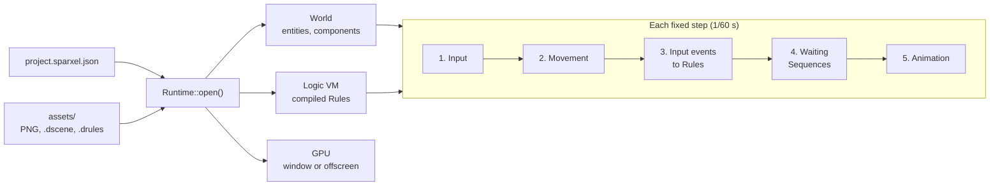

# Game: the Runtime

> **Status: v0.1, the first playable loop.** A project folder on disk (settings, PNG
> images, a scene and Rules) opens and runs: a hero walks with the keyboard or a gamepad,
> turning and animating as it goes, stopped by walls and people; Rules react to the game
> starting, to buttons, to talking to people, to walking through doorways and to
> animations finishing; people say things in message boxes ([ui.md](ui.md)); the player's progress saves to slots and loads back exactly; and
> the game draws pixel-perfect into a window that follows the hero. No-code logic reaches the world's entities by name or GUID, through all their
> components. Every behaviour below is covered by tests.
>
> Code: [`engine/game/include/engine/game/`](../../engine/game/include/engine/game/):
> [`runtime.h`](../../engine/game/include/engine/game/runtime.h),
> [`behaviours.h`](../../engine/game/include/engine/game/behaviours.h),
> [`logic_world.h`](../../engine/game/include/engine/game/logic_world.h),
> [`save.h`](../../engine/game/include/engine/game/save.h),
> [`dialogue.h`](../../engine/game/include/engine/game/dialogue.h) and
> [`clock.h`](../../engine/game/include/engine/game/clock.h). Tests:
> [`tests/game/`](../../tests/game/).

## 1. What it is for

`engine/game` connects the engine's parts into a game. The runtime opens a project
folder, loads its settings, assets, start scene and logic, then runs a loop of fixed
steps. An exported game runs exactly this, and the editor's Play button will run it too
(`plan/03` §8).



## 2. A project on disk

```
MyGame/
├── project.sparxel.json
└── assets/
    ├── art/hero.png (+ .meta)
    ├── maps/start.dscene      # a scene file (serialization.md §5)
    └── logic/main.drules      # a logic asset (serialization.md §4)
```

`project.sparxel.json` (`plan/03` §4) holds the settings:

| Entry | Meaning | Default and range |
|---|---|---|
| `format`, `version` | `"sparxel.project"`, version 1 | Required. A newer version asks the user to update Sparxel |
| `name` | The game's name | Required |
| `start_scene` | The scene to start in, a path inside `assets/` | Required |
| `ppu` | Pixels per world unit (one tile) | 16; 8 to 64 (`plan/04` §2) |
| `width`, `height` | The internal resolution, upscaled pixel-perfect | 320 × 180; 16 to 7680 × 4320 |
| `background` | The clear colour, `[red, green, blue]` | `[20, 24, 40]` |
| `render_style` | `"classic_2d"`, flat 2D, or `"diorama"`, the same world in 3D ([scene2d.md](scene2d.md) §7) | `"classic_2d"` |
| `gravity` | For Physics Bodies, `[across, down]` in tiles per second squared ([physics.md](physics.md)) | `[0, 0]`, each -1000 to 1000 |
| `camera_pitch`, `camera_distance`, `camera_fov` | The Diorama camera, which follows the hero: degrees looking down, tiles away, and vertical field of view | 35 (5 to 85), 12 (1 to 200), 30 (5 to 90) |
| `camera_clamp` | The camera stops at the map's edges (§3, Drawing) | `true` |
| `look` | The frame's post-processing: tilt-shift (Diorama style only: it imitates a lens photographing a miniature, so flat Classic 2D ignores it), bloom, grading and vignette ([rendering.md](rendering.md) §8). A group of named settings; unknown ones are reported, values out of range refuse the project | Changes nothing |
| `sprite_shadow`, `shadow_shape` | How dark each sprite's shadow is in the Diorama style, and its shape: `"cast"`, its silhouette laid away from the sun, or `"round"`, a blob at its feet ([scene2d.md](scene2d.md) §7) | 0.35 (0 to 1), `"cast"` |
| `block_shadow` | How dark the sun's shadows of blocks are in the Diorama style ([scene2d.md](scene2d.md) §7) | 0.45; 0 to 1 |
| `scene_fade` | Seconds the screen takes to fade to black when logic goes to another scene, and to fade back in; 0 cuts (§8) | 0.4; 0 to 3 |
| `sun_angle`, `sun_height` | Where the sun is at the start: degrees clockwise from north (up the map), and above the horizon. Logic moves it with the `lighting` object | 215 (0 to 360), 55 (5 to 90) |
| `ambient_light`, `sun_light` | The Diorama style's light at the start: from everywhere, and from the sun ([scene2d.md](scene2d.md) §7). Logic changes them with the `lighting` object | 0.55, 0.45; each 0 to 2 |

- Problems are reported in plain language with where they are, for example
  `project.sparxel.json/ppu`: *"This must be a whole number from 8 to 64."* A value out of
  range refuses the project. An unknown entry is reported and ignored.
- `project_to_json()` writes the settings back; reading them again gives the same values
  (tested).

## 3. Running a project

```cpp
std::vector<serialize::Issue> issues;
auto game = game::Runtime::open("MyGame", {}, issues);   // null if it cannot run
while (game && game->frame(seconds_since_last_frame)) {}
```

`Runtime::open()`:

1. Reads the settings, registers the engine's types, and creates the world.
2. Scans `assets/` (writing `.meta` files for new assets) and loads the start scene. A
   missing or unreadable start scene stops the game.
3. Compiles every `.drules` and `.dsequence` asset against the world's entities and loads
   it into the VM. An asset that does not compile is **left out and reported** with the
   block at fault, for example `assets/logic/bad.drules#block-7`; the rest of the game
   still runs.
4. Opens the GPU, an offscreen image at the internal resolution, and a window at the
   largest whole-number scale that fits 1280 × 720. A missing GPU stops the game only if
   graphics were asked for.
5. Emits `game_start`, so Rules such as *"When the game starts: …"* run once.

`RuntimeOptions`:

| Option | Use |
|---|---|
| `graphics = false` | No GPU at all: for tests, servers and tools. The simulation is identical |
| `headless = true` | Draws into the offscreen image only, with no window: for tests and thumbnails |
| `replay` | Plays an input recording instead of the keyboard and gamepads ([input.md](input.md)) |

### Each frame and each step

`frame(seconds)` asks the fixed-step clock (§7) how many steps are due, runs them, then
draws and presents. It returns false when the player closes the window. Each `step()`:

1. **Input.** The step's controls, from the recording or from the operating system.
2. **Movement.** While a message is open ([ui.md](ui.md) §3), movement and physics see
   no controls held, so the player stands still. Every enabled Top-down Mover walks, stopped by walls and Solid Bodies,
   and Walk Animations update (§4). Physics Bodies then take a step of the simulation, and
   those that start touching send **"touched"** ([physics.md](physics.md)). Then Trigger Areas send **"entered"** and
   **"exited"** for the movers that walked in or out.
3. **Input events.** Each action pressed this step emits `input.pressed` with the action,
   so *"When Interact is pressed"* Rules run. For Interact, each enabled mover (in GUID
   order) then reaches the Interactable it faces, which sends **"interacted"** (§4).
   While a message is open, Interact instead turns its page or closes it, and does
   neither.
4. **Logic update.** Events that scripts emitted since the last update are delivered,
   every Brain runs, then Sequences whose wait is over resume.
5. **Animation.** Sprite animations advance ([scene2d.md](scene2d.md) §3). Each one that
   reached its end sends its entity's **"finished"** event, so *"When the torch's
   animation finishes"* Rules run.
6. **Saving and loading** that logic asked for during the step (§8).
7. **A change of scene** that logic asked for (§8), then every Sound Source is set to how
   the player hears it now ([audio.md](audio.md) §4).

This follows the order in `plan/05` §5 so far; "continuously" Rules take their place in
it when they arrive.

### Drawing

`draw()` renders the world with `scene2d::draw_world()`, or in the Diorama style with
`scene2d::draw_diorama()` and the project's camera settings ([scene2d.md](scene2d.md)).
The camera follows the first entity with a Top-down Mover, so the hero stays centred,
except near the edges of the map: with `camera_clamp` on (the default), the camera stops
where the screen meets the edge of the tilemaps, so nothing beyond them shows
([scene2d.md](scene2d.md) §5). A map smaller than the screen is centred. In the Diorama
style, a view deeper than the map keeps its near edge on the map and lets the far side,
which reads as distance, show the background. The
**Lighting** object (`lighting`) gives logic *"Set the lighting's ambient light / sunlight
/ sun direction / sun height to [n]"*, so a Brain can make dusk and night, move the sun
and its shadows through the day, or a Rule darken a cave; Lights then stand out
([scene2d.md](scene2d.md) §7). It starts from the project's `ambient_light`,
`sun_light`, `sun_angle` and `sun_height` (`starting_lighting()`), and is saved with the
game (§8). `diorama_light()` turns it and the project's shadow settings into the light
a frame is drawn with, bringing anything logic set out of range back into it; the
editor's preview uses the same function. With a `look`, the world is drawn into a second target and post-processed into the frame;
the message box is drawn after, so text stays crisp. An open message box is drawn over the world ([ui.md](ui.md) §3). The window shows the image
pixel-perfect with black bars around it ([rendering.md](rendering.md) §4).

## 4. Behaviours

Behaviours are components that give an entity a capability with no logic to write
(`plan/05` §3.1). They live in `behaviours.h`, with their systems as plain functions
(`move_characters()`, `update_triggers()`, `find_interaction()`) that the runtime calls
each step and tests call directly.

Every behaviour's area is a box **centred on the bottom of its position** (`feet_box()`),
so the feet of a character, the base of a villager and the floor of a doorway line up
with their position, which is also what y-sorting uses.

### Top-down Mover

**Top-down Mover** (`top_down_mover`):

| Property | Meaning |
|---|---|
| `speed` | Tiles per second, 0 to 64 (default 4) |
| `enabled` | Turn off to stop the player moving, for example in a cutscene |
| `hitbox_width`, `hitbox_height` (advanced) | The feet, in tiles: 0.75 wide and 0.5 deep by default, centred on the bottom of the position |
| `facing` | Down, left, right or up. Set by walking; logic can set it too, to turn a character |
| `moving` (read-only) | Whether a move action was held in the last step |

It walks with the `move_up`, `move_down`, `move_left` and `move_right` actions, so the
arrow keys, WASD and the gamepad's d-pad all work. **Diagonals are as fast as straight
lines** (the direction is normalised; tested).

**Walls.** Solid tilemaps ([scene2d.md](scene2d.md) §4) stop the hitbox exactly at their
edge. Movement is resolved along x, then along y, so walking diagonally into a wall
slides along it at the diagonal speed (tested).

**Facing.** Walking straight faces that way. Walking diagonally keeps the current facing
if it is one of the two directions (so walking up-right while facing up still faces up),
and otherwise faces left or right.

### Jumping (seen from the side)

**Jumping** (`jumping`) turns the Top-down Mover on the same entity into a character seen
from the side, for platformers. The camera still follows it, and doorways, talking and
saves work as before, since it is still that mover.

| Property | Meaning |
|---|---|
| `gravity` | How fast falling speeds up, in tiles per second, every second (default 40) |
| `jump_height` | How high a jump reaches, in tiles (default 3) |
| `max_fall_speed` (advanced) | The fastest it falls, in tiles per second (default 20) |
| `fall_speed` (hidden) | How fast it is falling; below 0 it is rising. Saved with the game |
| `on_ground` (read-only) | Whether it stood on something after the last step |

- **Walking:** `move_left` and `move_right` walk it at the mover's speed and turn it to
  face that way; `move_up` and `move_down` do not move it.
- **Falling** (`fall()`): every step gravity speeds its fall, up to the fastest fall, and
  it moves down by that much, stopped by solid tiles and Solid Bodies as walking is.
  Stopped going down, it has landed (`on_ground`); stopped going up, it bumped its head
  and starts falling. It falls even when the mover is disabled, but it takes no input
  then; nor while a message is open or the scene fades.
- **Jumping:** pressing `jump` (Space, or the gamepad's South button) or `move_up` while
  on the ground leaps up at √(2 × gravity × height), which rises `jump_height` (a few
  hundredths less with whole steps of 1/60 s: 2.87 of 3 tiles; tested). Holding it does
  not jump again in the air.
- **The hitbox** is the mover's: make it as tall as the character (the platformer
  template uses 1 tile), since it bumps its head too.

### Walk Animation

The **Walk Animation** component (`walk_animation`) shows a character sheet: one row per
facing, in the order down, left, right, up from the top, each with the frames of a walk
cycle. Set the Sprite's frame size to one cell of the sheet.

| Property | Meaning |
|---|---|
| `frames_per_direction` | Frames in each row (default 3) |
| `frames_per_second` | Speed of the cycle while walking (default 6) |
| `standing_frame` | The frame shown when standing still, counted from 0 (default 1, the middle) |
| `ping_pong` (advanced) | Back and forth, 0-1-2-1, rather than starting over, 0-1-2-0 (default on) |

While walking, the row's frames cycle in fixed steps; on stopping, the standing frame of
the row shows and the cycle starts again next time. Do not combine it with an Animation
on the same entity: the Animation runs later in the step and would win.

### Walker (characters who walk by themselves)

A **Walker** (`walker`) on an entity with a Top-down Mover makes it walk by itself rather
than with the player's keys (`plan/02` H2, H4, H5): a villager going about, a guard on
patrol, a friend who follows, or someone logic sends somewhere. With a Walk Animation it
turns and walks as the player does.

| Walking (`mode`) | What it does |
|---|---|
| **Stand** | Stays where it is |
| **Wander** (the default) | Walks to a tile within *Wander within* (`wander_radius`, 3) of where it started, rests for *Rest* (`rest`, 1.5 s), and again. Its choices come from a seed taken from its GUID, so a game replays the same |
| **Patrol** | Walks its *Route* (`route`: points in tiles, `2,3; 8,3; 8,6`) one point after another, resting at each, round and round. Text that is not a point is passed over |
| **Follow** | Keeps within *Keep within* (`distance`, 1.5 tiles) of the entity named in *Follow* (`target`), finding the way again twice a second as it moves |
| **Go to** | Walks to (*Go to across*, *Go to down*), then stands and says **"arrived"** to Rules (*When it arrives*). A point it cannot reach leaves it standing |

Logic changes what it does: *Walk to {x}, {y}*, *Follow {name}*, *Wander* (near where it is
now), *Patrol* (from the route's first point) and *Stand still*.

**Finding the way** (`find_path()`): the map is a grid of tiles; the character fits in a
tile if its hitbox, standing in the tile's middle, touches no solid tile
(`scene2d::solid_at()`) and no enabled Solid Body but its own (and, following, not the one
it follows). A* searches eight ways round, never cutting across a wall's corner, the
shortest way first, up to 64 tiles around the start and the goal; the way is kept as the
points where it turns, then the goal. Each step the Walker heads for its next point,
slowing so as not to pass it (`steer_walkers()`, run before `move_characters()`, which then
moves it as it moves the player, sliding along walls). Pushed against something that
stepped into the way for ¾ s, it gives up that way: going somewhere or following, it finds
another; wandering or patrolling, it rests and goes on.

**Never the player.** A Walker is left out of everything that means "the player": the
camera and the ear follow the first Top-down Mover that is not walking by itself
(`player_position()`), and a Walker neither interacts nor sets off Trigger Areas, so a
wandering villager never walks through a door into another scene. While a message is open,
or a scene fades, Walkers stand still with everyone. Turned off (`enabled`), its mover is an
ordinary one again. Where it started, its rest and its place on the route are saved with
games; its way is found again after loading.

### Day and night

The Project view's *Day and night* sets how many real minutes a game day lasts
(`day_minutes`; 0, the default, has no clock and keeps the light as set) and the hour a
game starts at (`start_hour`, 12). With a clock, the **lighting** object's time runs on
each step and the light follows it (`daylight()` in
[`lighting.h`](../../engine/game/include/engine/game/lighting.h)), blended between
keyframes as HD-2D games light their days:

| Hour | Light |
|---|---|
| Night (20 to 4:30) | Dim, the moon high in the south, a blue tint |
| Dawn (6) | The sun rising in the east, low (long shadows), a warm tint |
| Noon (12) | The sun high in the south, bright, no tint |
| Dusk (18) | The sun setting in the west, low, an orange tint |

The sun's direction and height drive the Diorama style's shading and shadows; the **tint**
(the light's colour, each channel 0 to 2) colours the frame in either style, as part of the
Look ([rendering.md](rendering.md) §8), so Classic 2D games have nights too: there the
frame is also darkened by the ambient and sun light together (at most 1, so 1 by day and
0.4 at night), and Lights glow in it ([scene2d.md](scene2d.md), Lights in Classic 2D).
Logic uses
*Set the time of day to {hours}* (the light follows it), *Tint the light {red}, {green},
{blue}* (logic's own colour: the light stops following the time; *Light follows the time*
turns it back on), and reads or sets *Time of day*, *Day length*, and the tint's channels.
Saved games keep the time, the clock, and the colour. The editor's scene view shows the
starting hour's colour.

### Weather

Logic sets the weather on the lighting object: *Set the weather to {kind}, {strength}
strong*, with *rain*, *snow*, *fog* or *clear*, strength 0 to 1 (and the condition *It is
raining*). It covers the whole screen, over the world and under messages and menus: rain
darkens the scene a little and falls in slanting streaks; snow drifts down, nearer flakes
larger; fog veils everything in pale grey. Changes ease in and out over about two seconds
(a change of kind fades the old one out first). Saved with games. The drops are worked out
from a seed, so a recorded game replays the same. Pair it with sounds (a Sound Source of
rain) and Look changes for a storm.

### Particles

**Particles** (`particles`, [`particles.h`](../../engine/game/include/engine/game/particles.h))
send out pixels of colour where the entity stands (`plan/02` D12). A creator picks a
*Kind* and, if they like, *How many* a second, the *Area* they start in and their *Pixel
size* (1 to 4); 0 keeps the kind's own:

| Kind | What it does |
|---|---|
| **Fire** (30 a second) | Rises from a small area, drifting, yellow turning red and fading in under a second |
| **Smoke** (8) | Rises slowly, drifting with the wind, grey fading over 2 to 3 s |
| **Rain** (120) | Falls as two-pixel streaks from high above a wide area (20 × 12 tiles), slanting, and ends on the ground |
| **Snow** (40) | Falls slowly from high above a wide area, swaying |
| **Dust** (6) | Motes floating near the ground, glowing in and out |
| **Magic** (20) | Rises, swirling, cyan turning violet |
| **Sparks** (none on their own) | For *Send out {count} particles*: they fly out and fall back under gravity, yellow to orange |

Logic turns them on and off (*Start the particles*, *Stop the particles*: those flying
finish) and sends out bursts (*Send out {count} particles*, up to 500 at once). Each
particle moves on the ground (across and down the map) and in **height** above it, so the
same emitter reads the same in both styles: in Classic 2D height is up the screen, in the
Diorama style up in the world, drawn where the camera sees that point. They are drawn over
the world (not hidden behind walls) and before the Look, so bloom makes fire glow. At most
2,000 fly from one emitter. They move in the fixed step (`update_particles()`, after
animation) from a seed taken from the entity's GUID, so the same game replays the same
particles; flying particles are not saved with games. The editor's scene view does not play
them; Play does.

### The camera

The view follows the player: the first Top-down Mover that is not a Walker. How it follows
is set in the Project view's *Camera following* (`camera_smoothing`, `camera_dead_zone`,
`camera_look_ahead` in the project file), in either style, and logic changes it through the
**camera** object (`CameraObject`, [`camera.h`](../../engine/game/include/engine/game/camera.h)),
as the camera rigs of other engines do (`plan/02` D10):

| | What it does |
|---|---|
| **Smoothing** (0 to 2 s) | About how long the camera takes to catch up. Each step closes the same share of the gap for the same time (1 − e<sup>−t/smoothing</sup>), so it glides the same at any step length. 0, the default, keeps it exactly on the player, as before |
| **Dead zone** (0 to 16 tiles) | A square around the middle of the view in which the player moves without the camera moving; leaving it, the camera moves only as far as keeps the player on its edge |
| **Look ahead** (0 to 8 tiles) | The view leads the way the player walks, turning to a new way at 6 tiles a second, and settles back when they stop |
| *Camera follows {name}*, *Camera follows the player* | Someone else, such as a character in a cutscene (*Follows*, `follow`, holds the name), or the player again |
| *Camera looks at {x}, {y}* | Goes to a place and stays there, until it follows someone again |
| *Shake the camera by {strength} for {seconds} seconds* | Up to 4 tiles for up to 10 s, fading out: an explosion, a quake. The same step always shakes the same way, so recordings replay |

The camera moves once per fixed step (`update_camera()`, after the characters), and jumps
straight to its place when a game starts and when a scene changes, rather than gliding
across. The map's edges still stop the view (*Stay inside the map*), after all of this.

### Solid Body, Trigger Area and Interactable

| Behaviour | Properties | What it does |
|---|---|---|
| **Solid Body** (`body`) | `width` 0.75, `height` 0.5 tiles; `enabled` | Blocks movers like a wall that can stand anywhere: villagers, crates, signs. Movers stop exactly at its edge and slide along it. A mover's own body never blocks it. Bodies block where they stand at the start of the step |
| **Trigger Area** (`trigger`) | `width` 1, `height` 1 tiles; `enabled` | Sends **"entered"** when a mover's hitbox starts overlapping it and **"exited"** when it stops, once each, with the mover's name as `who` (its GUID if the name is shared). For doorways, cutscene zones and traps. Disabling it makes everyone inside exit |
| **Interactable** (`interactable`) | `width` 1, `height` 1 tiles; `enabled` | Sends **"interacted"**, with `who`, when a mover presses Interact facing it: the mover's hitbox moved half a tile (`interact_reach`) the way it faces must overlap it. The nearest one wins; ties go to the lower GUID |
| **Sound Source** (`sound_source`) | `sound`; `volume` 1; `range` 8 tiles; `playing` | Repeats a sound where it is, heard from the player: louder the closer they come, silent `range` tiles away, and from its side ([audio.md](audio.md) §4) |

Events are sent in a fixed order (exits before entries, then by trigger and mover GUID),
so a replay always runs Rules in the same order.

## 5. Logic meets the world

A Rule such as *"When the chest is opened: unlock it, add 10 gold"* names an object, the
chest, and members that live on different components: `unlock` on a Lock, `gold` on a
Purse. `logic_world.h` lets the logic runtime ([logic-runtime.md](logic-runtime.md)) find
that object in the world ([world.md](world.md)), and lets the compiler check the Rule
against it. The runtime does this for every project; on their own:

```cpp
world::World w(registry);
logic::Vm vm(registry);
game::attach(vm, w);   // scripts now reach w's entities

logic::CompiledLogic compiled = logic::compile(asset, registry, game::object_types(w));
vm.load(asset.name, compiled.source);
vm.emit("chest", "opened");
```

### How names resolve

| Name used in logic | Resolves to |
|---|---|
| 32 hexadecimal digits that are an entity's GUID | That entity |
| An entity's exact name, shared by no other entity | That entity |
| A name shared by several entities, or no entity at all | Nothing: the compiler reports *"There is no object called 'barrel'."*, and so does the VM at run time |

GUIDs never change, so the editor will write them into logic assets. Names are for
people, and for logic written by hand while they are unique. The runtime also binds the
`input` object, for conditions such as *"Interact is held"*.

### Tags: one Rule for many objects

A **Tags** component gives an object words that group it with others: *enemy, flying*
(separated by commas or spaces, any case). A Rule's object may then be a tag, written
`#enemy` and shown as *"When [who] touches it (any object tagged enemy)"*: it runs for
each tagged object's event, as GDevelop's object groups and Construct's families do.
Inside it, **it** is the tagged object whose event it is, for steps, conditions and
values (*Stand still (it)*, *Speed of it*); each run keeps its own *it*, across waits too,
so two slimes touched at once are each handled. The editor offers each tag's events in
*When…*, and *it*'s actions and values beside the objects'; *it* offers what any tagged
object has, and a step on a part a particular one lacks is reported when it runs.

| Name used in logic | Means |
|---|---|
| `#enemy`, as a Rule's object | Any object tagged enemy, in this scene or another |
| `it`, in a Rule about a tag | The tagged object whose event it is |
| `#enemy` as a step's object | Refused: *"A step cannot act on every object tagged 'enemy' at once…"*; use *For each* |
| `it` anywhere else | Refused: *"it" is the object in a Rule about a tag…* |
| A tag nothing has | Refused: *"No object is tagged 'dragon'."* |
| `who`, in a Rule whose event names an object | That object: what touched, interacted or walked in (the event's *who*) |
| `who` on an event that names none | Refused: *"who" is the object an event names… this Rule's event names none.* |

**Who.** Events that name another object carry it as their *who* value: a Solid Body's
*touched*, an Interactable's *interacted*, a Trigger Area's *entered* and *exited*. In a
Rule on such an event, **who** is also an object to act on: *"When [who] walks into the
pit: Go to … (game), Stand still (who)"*. It is compiled to the event's value itself, so
it is right for each run and across waits, and works whether the event names the object
by its name or its GUID. Since it could be any object, the editor offers what any of the
project's objects can do, and a step on a part the actual one lacks is reported when it
runs. `who` (like `it`) is a word logic keeps: an entity named so is reached by its GUID.

To ask *what* who is, the game object's condition **"{object} is tagged {tag}"** takes
the event's [who] (or any object's name): *"When [who] walks into the spikes: if [who] is
tagged hero, go to the scene “maps/start.dscene”"*. It is no for an object without the tag, or for no such object,
so it is safe whatever walked in. (`SaveObject::is_tagged()`, answered by the runtime
from the world being played.)

**For each object tagged enemy** is a step (with *Log*, *Wait* and *Repeat* in the
editor's list of steps): the steps inside it run once for each object with the tag, in
turn, each time as *it*, so *"For each object tagged enemy: Stand still (it)"* stops them
all. Inside a Rule about another tag, the loop's *it* is the loop's, and after the loop
the Rule's again. Its tag is one the project has (a tag nothing has is refused), and the
objects are found when the step runs, so ones made since are included. Saved as the step
kind `for_each_tagged`, its tag as the step's member; compiled to a Lua loop over
`sx.tagged(tag)`, which the world answers with the tagged objects' GUIDs
(`Vm::set_group_resolver()`).

How it works: `game::emit()` delivers each event under the object's names and then as
`#tag` for each of its tags, with the object's GUID after the event's values
(`logic::Vm::emit()` accepts that one extra value for a name starting with `#`). The
compiler gives a Rule about a tag one more parameter, `it`, and compiles steps on *it* to
use that parameter instead of a fixed name. (`Tags`, `tags_of()`, `tagged()` and
`logic_names()` in `engine/game`.)

### The inventory

The **Inventory** object (`inventory`, `inventory.h`) is what the player carries: keys,
coins, potions, each by name (spaces around it dropped) with how many, up to 999,999 of
each. It is saved with the game (§8).

| Block | Reads | What it does |
|---|---|---|
| `give(item, count)` | *Give {count} {item}* | Adds that many (from 1) |
| `take(item, count)` | *Take {count} {item}* | Takes that many away, never below none; at none the player no longer has it |
| `has(item)` | *The player has {item}* | At least one |
| `has_at_least(item, count)` | *The player has at least {count} {item}* | That many or more |
| `count_of(item)` | *The number of {item}* | How many; 0 for none |
| `kinds()` | *The number of different things carried* | How many different things |

The VM matches an event by the exact name a Rule was written with. So when the engine
sends an entity's own event, such as an animation's "finished", `game::emit()` sends it
under each name that reaches the entity (`names_of()`): its GUID, then its name if no
other entity shares it. A Rule runs once, whichever name it uses (tested).

### Creating and removing things

Logic makes things while the game plays, from prefabs ([editor.md](editor.md), Make a
prefab): a coin dropped by a beaten enemy, a crate from a machine, a monster joining a
fight. On the **game** object:

| Block | What it does |
|---|---|
| *Create {prefab} at {where}* | A copy of the prefab (`prefabs/coin.dprefab`) where something of that name (or GUID) stands: a chest, the player |
| *Create {prefab} at {x}, {y}* | The same at a point on the map, in tiles |
| *Remove {name}* | Takes something out of the scene, with everything under it |
| *The name of the last thing created* | A value, such as *coin_2* |

Copies are named after the prefab's first entity, numbered after the first (*coin*,
*coin_2*, *coin_3*), so Rules can name each one; they have new GUIDs, behave as placed
ones do, and are saved with games. Copies and removals happen at the end of the step
logic asked for them. A prefab that is not there, or a name nothing has, is reported in the
game's problems in plain language and nothing changes.

### Timers and messages

Also on the **game** object, for parts of a game that wait for each other:

| Block | What it does |
|---|---|
| *Start the timer {name} for {seconds} seconds* | A countdown; starting it again starts it over |
| *Stop the timer {name}* | It ends without telling Rules |
| *The timer {name} is running*, *The seconds left on the timer {name}* | A condition and a value |
| *When a timer ends ({name})* | An event with the timer's name |
| *Send the message {name}* | Every Rule on *When a message is sent* hears it, with its name, at the end of the step: one part of the game telling others (*door_opened*) |

Timers count while the game plays, not while the title screen or pause menu is open, and
are saved with games, with their seconds left.

### Achievements

| Block | What it does |
|---|---|
| *Unlock the achievement {name}* | Kept for the player across every save and every time they play, and announced once |
| *The achievement {name} is unlocked*, *The number of achievements unlocked* | A condition and a value |

An achievement unlocked slides down at the top of the screen for three seconds
(*Achievement unlocked* over its name, in the look of menus and messages), one after
another. Its name is the `name` of its row of `data/achievements` (any other columns, such
as a `description`, are for the creator), or else the name logic gave. They are kept in
`achievements.json` beside the save slots, so loading an old save, or starting a new game,
keeps them.

### The minimap

With **Minimap** ticked (the Project view's *Menus and messages*; `minimap`), a small map
shows in the top-right corner: the tiles of every visible tilemap within 20 tiles of the
player, two pixels each (those of solid maps as walls, in the look's border colour; the
rest as ground, in its hint colour), people and things to talk to (Interactables) as dots,
and the player in the middle in the highlight colour. It is not drawn over menus, shops or
battles. Logic shows and hides it (*Show the minimap*, *Hide the minimap* on the game
object), as for a cut scene or a maze.

### Quests and the journal

The **quests** object (`QuestObject`, [`quests.h`](../../engine/game/include/engine/game/quests.h))
holds the story's tasks (`plan/02` G5), each by a name logic uses (*cat*) with a title the
player reads (*The lost cat*):

| Block | What it does |
|---|---|
| *Start the quest {name}: {title}* | Starts it at stage 0 (the title is the name if left empty). Starting it again changes nothing |
| *Set the objective of {name} to {objective}* | What to do now, as the journal shows it: *Look by the well* |
| *Move the quest {name} to stage {stage}* | Where it has got to, 0 or more, for Rules to check |
| *Complete the quest {name}*, *Fail the quest {name}* | Finishes a quest under way; a finished one stays as it is |
| *Show the journal* | A message box: *Journal*, then each quest under way with its objective, then the finished ones marked *(done)* or *(failed)*, each in the order it started; *The journal is empty.* without any |
| Conditions | *The quest {name} has started*, *is under way*, *is complete*, *has failed* |
| Values | *The stage of {name}*, *The number of quests under way* |

Names have spaces around them dropped, as the inventory's do. Saved games keep every quest
(its title, objective, stage, state and order); loading replaces them, and a saved quest
without a title is left out with a note. At most 1,000 quests are kept.

## 6. Objects made of several parts

- `Vm::set_object_resolver()` lets the VM ask for an object's parts by name whenever a
  script uses one. For an entity, the parts are its components. `sx.call`, `sx.get`,
  `sx.set` and `Vm::emit()` use the first part that has the member asked for.
- **No addresses are kept.** The resolver runs at every access. Adding a component, or
  creating entities, can move a component's data (flecs stores components in tables);
  logic keeps working because it never holds the old address (tested).
- The compiler's `ObjectTypes` gives all of an object's types, and every lookup searches
  across them, so Rules are checked against everything the entity really has.
- Objects bound with `Vm::bind()` still work and take precedence over the resolver.

## 7. The fixed-step clock

`FixedStepClock` (`clock.h`) turns real frame times into a whole number of simulation
steps (1/60 s by default), plus `alpha`, how far the next step has come, for interpolated
drawing (`plan/03` §7).

- Exact frame times give exact steps: 600 frames of 1/60 s are 600 steps (tested), despite
  rounding in the running sum.
- After a long stall, at most `max_steps` (8) run in one frame and the rest of the backlog
  is dropped (reported in `dropped`), so the game recovers instead of spiralling.
- The runtime numbers its steps itself (`Runtime::step_count()`), which is the step
  number input recordings use.

## 8. Saved games

A save (`Runtime::save()`, format `"sparxel.save"` version 1, `plan/03` §10) holds:

| Entry | What |
|---|---|
| `game` | The project's name: another game's saves are refused |
| `step` | The step count, so recorded input and timers continue from the same step |
| `scene` | The scene the save was made in, by its path in `assets/`. Optional: a save without it is in the scene being played |
| `world` | Every entity and component, as a scene with GUIDs ([serialization.md](serialization.md) §5), including hidden state such as an animation's time |
| `variables` | Every logic asset's variables, by asset and name (`Vm::variables()`) |
| `lighting` | The `lighting` object's ambient light, sunlight, sun direction and sun height. Optional: a save without it (or without some of them) keeps the current values |
| `inventory` | What the player carries: each thing's name and how many (a whole number above 0). Loading empties the inventory first; anything else is left out with a note. Optional: a save without it leaves the player carrying nothing |

**Loading** (`Runtime::load()`) checks the whole save first, loading its world into a
scratch world. A save from another game or a newer version, or a broken world, is
refused and **changes nothing** (tested). Otherwise the world is replaced, waiting
Sequences stop (`Vm::stop_all()`; a save does not hold them, so save where none is
running, as RPGs do at save points), open messages close, and the variables are restored. A variable that no
longer exists, or now holds another kind of value, keeps its current value and is
reported; the rest still loads. Movers standing in Trigger Areas count as already
inside, so loading does not set off "entered". Saving straight after loading gives the
same save (tested).

**Slots.** The **Game** object (`game`) gives logic *"Save the game in slot [n]"*, *"Load
the game from slot [n]"* and the condition *"Slot [n] has a save"*, for slots 1 to 99.
Saving and loading happen at the end of the step (step 6), after every script has run,
so no Rule ever sees a half-loaded world. Problems are collected in `problems()`.

**Scenes.** A game is made of scenes (maps): the project's `start_scene`, and any other
`.dscene` in `assets/`. The Game object gives logic *"Go to scene [scene]"*, *"Go to scene
[scene], arriving at [where]"* and the condition *"The scene is [scene]"*; scenes are
named by path (`maps/cave.dscene`) or GUID.

- The change happens at the end of a step (step 7), like saving: the rest of the Rule
  that asked for it runs first. `Runtime::change_scene()` does it, and `scene()` says
  which is being played.
- **It fades:** over `scene_fade` seconds (0.4 by default) the screen darkens to black,
  the scene changes, and it lightens again over as long; `fade()` says how dark it is,
  0 to 1, and the black is drawn over everything, the message box too. While it fades
  nobody walks, and Sound Sources fade with the picture. Asking again while it fades
  in turns it back towards black from where it is; with `scene_fade` 0 the scene cuts at
  the end of the step. `change_scene()` itself never fades.
- The new scene is checked whole in a scratch world first: one that is missing, is not a
  scene or cannot be loaded **changes nothing** and is reported in `problems()`.
- The world is replaced; **variables, waiting Sequences, an open message, music and the
  lighting carry on**. With *arriving at*, the player (the first Top-down Mover of the
  new scene) is put where the entity of that name is; if there is none, the scene still
  changes and the problem is reported.
- Then Rules on the game-wide event **"scene_start"** run (*When a scene starts*). It is
  not sent for the first scene: that is "game_start".
- Logic is compiled once, for the whole game: an entity of any scene can be named in
  Rules, and their events reach those Rules while its scene is played. Acting on an
  entity of a scene that is not being played is a script error, reported like any other.

- Slot files (`slot-07.sparxel-save`) are JSON, written **atomically**: to a temporary
  file that then replaces the slot in one step, so a crash or power cut while saving
  leaves the previous save intact.
- They go in `RuntimeOptions::save_folder`, or by default the player's own folder for the
  game that the operating system suggests (`SDL_GetPrefPath`; on Windows under
  `AppData\Roaming\Sparxel`), found only when a save is first used.

## 9. Tests

| Test | Checks |
|---|---|
| Project settings | A missing file; a round trip; out-of-range values, a wrong style and an unknown entry, each reported at its path; another format or a newer version refused |
| Recorded input | A temporary project on disk. Right held for 30 steps, in frames of one and two steps, walks the hero exactly 2 tiles; the game-start Rule logs once; Cancel does not trigger the Interact Rule, Interact does; the torch's one-shot animation runs its "finished" Rule once, at 0.3 s |
| Diagonals | Right and down for one second move 4/√2 tiles on each axis; a disabled mover stays put |
| Walls | Walking right stops with the hitbox on the wall (x = 2.625 for a wall at 3); adding down slides along it at the diagonal speed |
| Bodies, triggers, interaction | Boxes touching versus overlapping; sweeping against boxes in every direction; a villager stopping the hero at its edge, and not when disabled; a doorway reporting a mover already inside, a mover walking in and out once each, exits in GUID order, and everyone leaving when disabled; the reach in each facing, the nearest of two, disabled ones and the mover itself skipped |
| Talking and doorways | In the runtime: Interact facing the elder runs its "interacted" Rule after the Interact input Rule, and the next Interact closes what the elder said; walking left runs the doorway's "entered" Rule with `who` = "hero" at exactly 4.2 tiles, and "exited" after leaving it |
| Falling and jumping | `fall()` on its own: pressed against the floor it is on the ground; a jump rises between 2.8 and 3 tiles and lands in 44 to 48 steps (0.77 s); held, it does not jump again in the air; a ceiling a tile up stops the rise and it falls back; it falls no faster than 20 tiles a second; gravity that is not a number moves nothing. In a world: a hero with Jumping falls onto a solid floor and stands on it; Down does nothing; Right walks 2 tiles in half a second facing right; Space and Up jump it off the floor and it lands again; it lands on a Solid Body's top and falls back to the floor walking off it; disabled, it neither walks nor jumps but still falls |
| Facing and walking | Every facing rule; exact frames of the cycle, back and forth and starting over, at 6 frames per second; the standing frame; clamped settings; the runtime turning the hero left and animating it |
| Problems | A Rules asset naming a missing object is reported at its block and left out, and the game still runs; a missing start scene stops it |
| Drawing (GPU) | Exact pixels: the hero centred, and after walking one tile the rock drawn 8 pixels to the left |
| Look | Read and written exactly; a value out of range, one of the wrong kind and a look that is not a group refuse the project, an unknown name is reported; on the GPU, exposure 2 doubles the world's colours while the message box keeps its exact border; in Classic 2D, even the strongest tilt-shift leaves every pixel as it was |
| Inventory | On its own: names with spaces around them, giving and taking, never below none, nothing for no name or a count below 1, at most 999,999. In a game: Rules on starting give 4 coins and a key and take a coin back, and another, as the player has the key, logs 3 coins, 2 kinds of thing and 1 of what a text variable names (the key); saved and restored; a save with a negative count and a count that is not a number leaves both out with two notes; a save without it leaves nothing carried |
| Lighting | The project's light, sun position and shadow settings round-trip; out-of-range values and an unknown shadow shape are refused; the `lighting` object starts from them, the light drawn with matches them, and a Rule sets all four; values logic sets out of range are brought back into range when drawn; all four are saved and restored |
| Camera on the map (GPU) | The hero in a map's corner drawn off-centre where the clamped camera puts it, and centred with `camera_clamp` off; the sample village in the Diorama style with no background on any edge of the screen (this fails without the clamp) |
| Diorama (GPU) | The same project in the Diorama style: the hero drawn as a billboard above the centre, lit as `brightness()` says; the settings round-trip; an unknown style and an out-of-range camera refused |
| Logic and world | Names and GUIDs resolve; an entity's event reaches Rules written with its name and with its GUID, once each; Rules act through several components; logic survives storage moves |
| Clock | Exact stepping, stalls and the step cap |
| Save files | Slot file names and limits; atomic writes creating folders and replacing files, leaving no temporary file; a failed write reported |
| Saved games | A save restores a moved hero, a destroyed rock, a variable and the step count; an exact round trip; logic acting on the loaded world and its restored variable; other formats, newer versions, other games and broken worlds refused with nothing changed; a vanished variable reported while the rest loads |
| Slots from logic | Cancel saves in slot 2 and Menu loads it at the end of their steps, putting the hero back; an empty slot and slot 0 reported |
| Scenes | A second scene with a bat only it has, whose Rule compiles while the first scene is played; walking into a doorway runs *Go to scene … arriving at stairs*: the rest of that Rule runs first, the world is the cave's alone, the hero is exactly at the stairs, *When a scene starts* runs once (and *The scene is …* is true), the game start is not repeated, and the hero walks on; a save names its scene; going back by GUID with a missing arrival spot changes scene and reports it; a missing scene and a picture change nothing; loading the save returns to the cave ; the fade: the request starts it at 0, it darkens by 1/24 a step (0.4 s) while the scene stays and the hero, Left held, does not move, the scene changes when it is black, it lightens by 1/24 a step, and only then does the hero walk; the setting round-trips, and 3.5 or text are refused. Drawn (GPU): half-way every pixel at half brightness, at the change all black, then the scene as it was |

## 10. Next increments

1. **"Who", further** (`plan/05` §2): a *Choose* step picking one tagged object (the
   nearest, at random); tags, *it*, *For each*, *who* and *is tagged* are done (§5).
2. **Play in the editor** (`plan/03` §8): the runtime inside the editor's own window, as
   well as in `sparxel-player` (F5 today, [player.md](player.md)).
