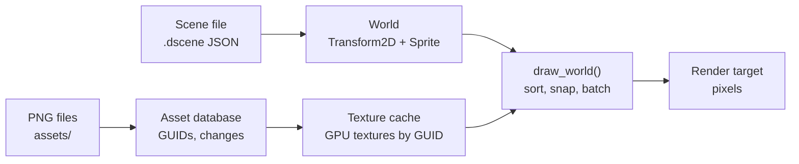
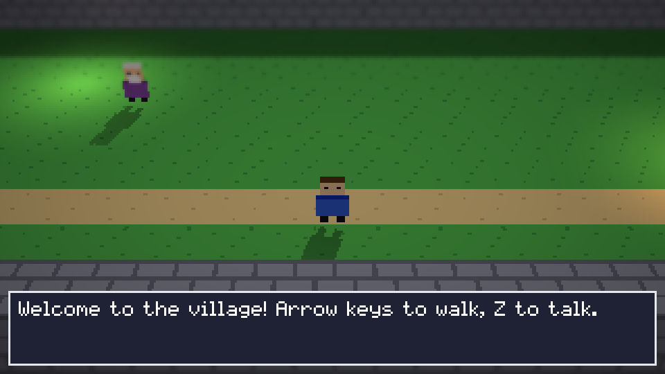

# Classic 2D Scenes

> **Status: v0.2.** Entities with a position and a sprite, whose images are PNG assets
> referenced by GUID, drawn through a pixel-perfect camera. Sprite sheets with frame
> animation, and tilemaps drawn only where they are in view, whose solid tiles block
> movement. Scenes save to JSON and render
> identically after loading, and editing a PNG hot-reloads it. Every behaviour below is
> covered by tests.
>
> Code: [`engine/scene2d/include/engine/scene2d/scene2d.h`](../../engine/scene2d/include/engine/scene2d/scene2d.h)
> and [`src/scene2d.cpp`](../../engine/scene2d/src/scene2d.cpp). Tests:
> [`tests/scene2d/scene2d_test.cpp`](../../tests/scene2d/scene2d_test.cpp).

## 1. What it is for

This is where the engine's parts first work together, in the **Classic 2D** render style
(`plan/04` §3):

The Diorama style (3D world, lit billboards) builds on the same components and caches.

## 2. Components

Both are reflected types, so the inspector, no-code blocks and scene files get them with
nothing extra to write ([reflection.md](reflection.md)).

| Component | Properties | Shown as |
|---|---|---|
| `Transform2D` ("transform_2d") | `x`, `y` in **tiles** (world units), `layer` (advanced) | "Position" |
| `Sprite` ("sprite") | `image` (an asset GUID), `visible`, `recolor` (*Recolour*: a palette swap), `rotation` (degrees), `scale_x` and `scale_y` (*Scale across*, *Scale down*); advanced: `pivot_x`, `pivot_y`, tint red, green, blue, and opacity; `frame_width`, `frame_height` and `frame` for sprite sheets | "Sprite" |
| `SpriteAnimation` ("sprite_animation") | `tag` (a tag of the sheet, such as *walk*: §3), `first_frame`, `frame_count`, `frames_per_second`, `loop`, `playing`; actions *Play*, *Play the animation {name}* (a tag) and *Stop*; event *finished* | "Animation" |
| `Tilemap` ("tilemap") | `tileset` (an asset GUID), `tiles`, `visible`, `solid`; advanced: `tile_size`, `shapes` (*Tile shapes*) | "Tilemap" |

- **Units:** one world unit is one tile of `ppu` pixels, the project setting (default 16,
  `plan/04` §2). A sprite's size comes from its image: 1 image pixel is 1 world pixel.
  Creators never type sprite sizes.
- **The pivot** is the point of the image placed on the position. The default, bottom
  centre, puts a character's feet on its position, which is what depth sorting needs.
- **Turning and scaling** happen about the pivot: `scale_x` and `scale_y` stretch the
  picture (2 is twice the size; below 0 flips it), then `rotation` turns it clockwise, in
  degrees. `sprite_corners()` gives where the four corners go, and the game, the Diorama
  style and the editor's picking all use it, so they agree. An upright picture keeps its
  left and top edges on whole pixels, as before; a turned one keeps its pivot on a whole
  pixel, and quarter turns are exact (turned pixel art stays whole pixels). Only the
  picture turns: solid tiles, bodies and areas keep their own shapes.
- **Palette swaps** (`plan/02` B4). `recolor` draws some of the picture's colours as
  others: `#46b450>#c83c3c, #aaf0a0>#f0b0b0` makes a green slime red, with no second
  picture to keep in step. Each exact colour (alpha kept) is swapped once, so swapping two
  colours both ways works. The texture cache makes each recolouring once, keyed by the
  picture and the text, and forgets it when the picture changes, so recoloured sprites are
  as fast as plain ones; the game, the Diorama style and the editor's view all draw it.
  Logic can change `recolor` like any property (a hurt flash, a team colour).
  (`parse_recolor()`, `recolor_text()`, `recolor_image()`, `image_colors()`,
  `TextureCache::get(image, recolor)`.)

## 3. Sprite sheets and animation

- **Frames.** With `frame_width` and `frame_height` set, the image is a grid of frames,
  numbered from 0 left to right, then top to bottom. `frame` picks one; numbers past the
  last frame wrap around. With a size of 0 (the default) the whole image is one frame, so
  scenes from v0.1 are unchanged.
- **Animation.** `animate(world, seconds)` advances every playing SpriteAnimation and sets
  its Sprite's `frame` to `first_frame` plus the frame reached. It runs once per fixed
  step, so animations are frame-rate independent and replay exactly. At 10 frames per
  second and 60 steps per second, a new frame shows every 6 steps exactly (tested; a tiny
  tolerance absorbs rounding in the running time).
- **Looping or once.** A looping animation starts again after its last frame. One that
  does not loop stops on its last frame, sets `playing` to false, and `animate()` returns
  the entity once, so the runtime can send its **"finished"** event to Rules
  ([game.md](game.md) §3).
- *Play* starts again from the first frame; *Stop* keeps the frame shown. The time played
  so far is a hidden property, saved with scenes.
- **Tags.** Sprite Studio saves, beside a sheet `art/hero.png`, its description
  `art/hero.sheet` (`format` *sparxel.sheet*): the frame size, how long each frame shows,
  and its tags, named runs of frames that play forward, backward or ping-pong (forward and
  back, without showing the end frames twice). With `tag` set to one of them (*walk*),
  `animate()` plays that tag's frames, each for its own time, and sets the Sprite's frame
  size from the sheet, so nothing about frames needs typing in. Not looping, it stops on
  the last frame it shows and says it finished, as above. A tag the sheet does not have,
  or a picture without a `.sheet`, plays the frames by number as before. *Play the
  animation {name}* switches tag from logic, starting from its beginning.
  `SheetLibrary` reads each picture's `.sheet` on first use (found by the picture's path:
  `sheet_path()`), as `TextureCache` reads textures, and `apply()` forgets them after
  asset changes; the game's runtime keeps one and passes it to `animate()`.
  `parse_sheet()` keeps frame times within 1 to 65,535 ms and drops tags outside the
  frames.

## 4. Tilemaps

- A Tilemap is a grid of square tiles from one **tileset** image, with its top-left corner
  at the entity's Position. Tiles are numbered like sprite sheet frames. `tile_size` 0
  (the default) uses the camera's pixels per tile, so a tile is one world unit.
- **Stored as text** so scene files stay readable and diff well: one line per row, cells
  separated by commas, each a tile number, or empty (or -1) for no tile. `parse_tiles()`
  reads it strictly; a bad cell is reported by row and column, for example *"Row 2, column
  2 is 'x', which is not a tile number (a whole number from -1 up)."* Short rows are
  filled with empty cells. `format_tiles()` writes it back, and reading that gives the same
  grid (tested).
- **Hostile input:** a map is at most 4,096 tiles on each side. Text cannot make the
  engine allocate more than that.
- The component keeps the parsed grid until its text changes, so drawing does not parse
  every frame. The cache is not reflected, so it is never saved.
- **Drawing** computes the columns and rows in view and draws only those, in one batch per
  tileset: in a 100 × 100 map, an 8 × 8-pixel view of 2-pixel tiles draws 16 tiles, or 25
  when the camera is half a tile off the grid (tested). Tile numbers past the end of the
  tileset are skipped.
- A tilemap sorts like a sprite whose `y` is the map's top edge. Put ground maps on a
  lower `layer` than characters. If an entity has both a Tilemap and a Sprite, the sprite
  is drawn over the map.
- **Animated tiles** (`animation_frames`, `animation_fps`): water, lava or flowers in the
  wind. Each painted tile shows itself and then the next tiles of its tileset in turn
  (`Tilemap::shown()`), looping; a tile whose next one would run past the tileset stays
  as it is. `animate()` moves the map's hidden, saved `elapsed` on with the sprites'
  animations. Put animated tiles on their own map, with their frames side by side in
  the tileset.
- A Tilemap's `opacity` (0 to 1) makes its tiles see-through, in both styles: water
  painted on a map a layer above the riverbed, or glass blocks in the Diorama style.
  What is behind shows through, blended (in 3D, farthest first: [rendering.md](rendering.md)
  §7). A sprite's `tint_a` does the same for a character, such as a ghost fading in.

- **Tile heights** (`heights`, *Tile heights*, advanced): in the Diorama style each tile
  can stand at its own height, for terrain built tile by tile, as Crocotile-style tools
  build it: text like `tiles`, a number per cell from 0 to 16 (halves and quarters allowed;
  `parse_heights()`, `format_heights()`), an empty cell standing at the map's `height`
  (`Tilemap::height_at()`). A block's sides show down to the ground beside an empty cell,
  and down to a lower neighbour's top beside a lower one, so steps and cliffs read as such.
  Sprites' shadows lie on the tile's own top (`ground_top()`), and the sun's shadow map
  reaches the tallest tile. The editor's **Raise** and **Lower** brushes paint them
  ([editor.md](editor.md)).

### Solid tiles

- With `solid` on, every tile of a map blocks movement. Walls go on their own map; hide it
  if the wall art is painted on another one.
- `sweep(world, box, axis, distance, ppu)` says how far a box (in world units, edges
  half-open) can move along one axis: the whole distance, or up to the edge of the first
  solid tile in the way, or 0 when it already touches one. Moving one axis at a time
  lets characters slide along walls ([game.md](game.md) §4).
- **Exact and safe at the edges:** positions within 10⁻⁹ of a tile edge count as on it, so
  rounding in the sum of many small steps never lets a box slip into a wall. Tiles the box
  already overlaps do not block, so a character placed inside a wall can walk out. Boxes
  with broken (non-finite) positions and maps with invalid text are ignored.
- Only the tiles between the box and its destination (and one beyond) are checked, so the
  cost does not depend on the map's size: each is made a box of what it blocks, and the
  boxes are swept against as `sweep_boxes()` does.
- **Tile shapes:** a solid map's advanced *Tile shapes* names tiles that block only part
  of their square, by their number in the tileset: `12 top, 13 bottom, 7 none` (shapes
  `full`, `none`, `top`, `bottom`, `left`, `right`, any case). A top half is a ledge to
  walk under, a bottom half a low wall seen from the side, `none` a tile painted on the
  wall map that blocks nothing (a doorway, a flower). Tiles not named block all of their
  square. In the editor, right-click a tile in the Tiles palette: *Blocks ▸ All of it /
  The top half / … / Nothing*, one undo step (the text keeps only the tiles that differ
  from *All of it*). Unreadable pairs are skipped (`parse_tile_shapes()`,
  `tile_shape_box()`).

### Auto-tiles

Terrain such as water, cliffs or paths needs a different tile at each edge and corner.
As in RPG Maker, an artist draws a terrain as one **block of 2 × 3 tiles**: top left, how
it looks in the palette; top right, its four inner corners (each quarter a corner cut into
the terrain); below, a 2 × 2 patch of it with its border all round. A picture may hold many
blocks, side by side and in rows.

- **Make auto-tiles** (right-click a picture in the Assets; `Document::make_autotiles()`)
  writes `<name>_auto.png` beside it, at the project's pixels per unit: for each block, the
  47 shapes the terrain takes beside itself (the "blob" set), each put together from four
  quarter tiles of the block (an outer corner, an edge, an inner corner or the middle,
  picked by the neighbours on that quarter's sides and corner), and the preview last: 48
  tiles a terrain, 8 a row (`assets::expand_autotiles()`). Odd tile sizes, or a picture
  smaller than a block, are refused in plain language.
- A tilemap with **Auto-tile** on (`autotile`) uses such a tileset: the Tiles palette
  shows one tile per terrain, and painting it, by pencil, rectangle or fill, gives every
  cell it touches, and those around, the shape its neighbours of the same terrain make.
  Erasing does the same for the cells around. A corner neighbour counts only with both
  sides beside it. Past the map's edges counts as empty. Fills treat every shape of a
  terrain as that terrain.
- The game draws the tiles painted, as for any map: nothing is worked out while playing.
  Put each auto-tile terrain on its own map, over the ground.

## 5. Drawing

`draw_world(world, textures, sprites, target, camera, clear)` draws every visible entity
that has a Position and a Sprite or a Tilemap.

- **Order:** by `layer`, then by `y` (lower on screen is in front, so characters walk
  behind and in front of each other naturally), then by the entity's GUID. Ties never
  depend on storage order, so the same scene always draws the same way.
- **The camera** (`Camera2D`) has a position in units, the PPU, and a whole-number
  `scale`. Positions are **snapped to whole image pixels before upscaling**, so pixel art
  never shimmers or shows half pixels (`plan/04` §3: "pixel-snapped camera").
- **Missing images** (an unknown GUID, a file that is not a PNG) and tilemaps whose text
  is not valid are counted in `DrawStats::missing` and skipped. An image's error is in
  `TextureCache::last_error()`. `DrawStats::drawn` counts sprites and tiles.

### Keeping the camera on the map

So that the void beyond a map's edges never shows, a game keeps its camera inside the
map ([game.md](game.md) §3):

- `map_bounds(world, ppu)` is the box around every tilemap's grid, visible or not.
- `clamp_view(x, y, view, bounds)` moves the point a camera looks at as little as
  possible, so that `view` (what the camera shows around the point) stays inside
  `bounds`. On an axis where the view is larger than the map, the view is centred on it.
  An infinite edge of the view is never limited.
- In 2D, the view is the screen: half its width and height, in units, either side of the
  point.

## 6. Textures and hot reload

- `TextureCache` loads an image asset onto the GPU the first time it is drawn, and keeps it.
- Pass every `AssetDatabase::refresh()` result to `TextureCache::apply()`. Modified and
  removed images are dropped and reload on their next use. Moved images keep their
  texture, since the GUID and content are unchanged.

A test repaints a PNG on disk from blue to green; after `refresh()` and `apply()`, the next
frame shows green.

## 7. The Diorama style

`draw_diorama(world, textures, renderer, target, camera, clear, light, fog)` draws the same
world in 3D, the HD-2D look (`plan/04` §4). Nothing in the scene changes: a project picks
the style ([game.md](game.md) §2).

- **Space:** a map position (x, y) is the world point (x, 0, y): the ground is the x-z
  plane, up is +y, one unit is one tile.
- **The camera** (`DioramaCamera`) orbits the point it looks at: `pitch` (how far it looks
  down, kept from 5 to 85 degrees), `yaw`, `distance` and a narrow vertical `fov` (30
  degrees by default, the telephoto look of HD-2D). With yaw 0 it stands south of the
  point, so north is up the screen, as in the 2D view. The point is at the centre of the
  image (tested).
- **Sprites** are upright billboards (`plan/04` §5.1, "Upright"): they turn about the
  vertical axis to face the camera, with their pivot on the map position, so feet stand on
  the ground. 1 image pixel is 1/`ppu` of a tile, as in 2D. A sprite's scale and rotation
  apply in the billboard's own plane, as seen; its shadow follows the turned shape,
  darkest at its lowest corner.
- **Tilemaps** are the ground. A Tilemap's `height` turns every tile into a block of that
  many tiles, with the tile's picture on its top and sides; sides are drawn only where no
  neighbouring block hides them (one block is 5 quads; two side by side are 8; tested).
  Layers lift maps a hair (0.002 tiles each), so maps painted over each other do not
  flicker.
- **Lighting** (`DioramaLight`): every face gets `ambient` plus `diffuse` times how much it
  faces the sun (`brightness()`), so tops, sides and sprites shade differently. Tests
  check the exact colours this gives.
- **Light** (`light`): a point light at an entity's position, `height` tiles above the
  ground, reaching `radius` tiles, in its colour times `intensity`; warm torchlight by
  default. The 16 enabled Lights nearest the point the camera looks at are used
  (`diorama_lights()`, ties by GUID), per pixel ([rendering.md](rendering.md) §7). Ground
  and block faces take them from the front; sprites, as billboards, softly from all round
  and in their tint. Lights add to the ambient and sun light, so they show best when
  those are low: the game's `lighting` object sets them ([game.md](game.md) §3).
- **Lights in Classic 2D** (`draw_lights_2d()`): drawn over the frame once the Look has
  graded and darkened it, each brightens what is there in its colour, fading to nothing at
  its `radius`, with its middle `height` tiles above its position (a torch's flame). What
  shows is the scene times the night's tint *plus* the light, so a torch stays warm in a
  blue night and the art's own detail shows through it (the sprite renderer's
  `Blend::Light`: what is there times one plus the light). Lights show a quarter as
  strongly in full daylight as in the dark (`lights_2d_strength()`), take the Look's
  saturation (grey under a black and white look), and an `intensity` above 1 brightens in
  steps up to 8. The game and the editor's view draw them alike. Classic 2D's darkness
  itself comes from the ambient and sun light together (`classic_brightness()`: their sum,
  at most 1; 1 by default, 0.4 at night on the clock), times the tint.
- **The sun** is placed by an angle and a height (`sun_direction()`): degrees clockwise
  from north (up the map) and above the horizon. By default it is in the south-west
  (215 degrees), 55 degrees up, behind the camera and a little to its left, so shadows
  fall up the screen and to the right.
- **Shadows** (`plan/04` §5.4): each sprite casts one, `sprite_shadow` dark (0.35 by
  default; 0 turns them off), lying on the top of the highest tile under its feet
  (`ground_top()`), so on blocks too. Where no tile is under a sprite, it casts none,
  rather than darkening the sky. Two shapes (`ShadowShape`):
  - **Cast** (the default): the sprite's own silhouette, its picture's opaque pixels,
    laid on the ground away from the sun. A sprite stands for a solid figure, so its
    shadow is cast as if the picture turned to face the sun: as wide as the picture
    across the shadow and as long as the picture's height makes it at the sun's height
    (`shadow_offset()`: a tile per tile of height at 45 degrees, at most 3), darkest at
    the feet and fading to 0.6 of that at the head's end. A flat picture cast by
    parallel rays onto flat ground is a parallelogram, so one quad draws it exactly. The
    sun straight overhead shrinks it to nothing; choose Round for a noon sun.
  - **Round**: a soft blob at the feet, whatever the sun.

  Sprites' shadows lie on the ground and do not fall on other sprites or up the sides of
  blocks; where two overlap, they darken twice.
- **Blocks' shadows** (`block_shadow`, 0.45 by default; 0 turns them off) come from a
  real shadow map: the renderer draws every block and tile from the sun first
  (`diorama_sun_shadow()` fits the sun's orthographic view to the maps, as high as the
  tallest block, or to 96 tiles around the camera on larger ones), then darkens the
  sun's part of the light wherever something stands between a surface and the sun. So
  walls and houses shadow the ground, other blocks and the characters walking past, on
  the side away from the sun, and the shadows move with it. Sprites receive them but do
  not cast into the map (seen from the sun they are edge-on cards); they have their own
  silhouettes above.

  
- **Depth** sorts everything; there is no draw order to manage. **Fog** fades distant
  things into the haze.
- **Rays** (`diorama_ray()`, `ground_hit()`): the ray from the eye through any point of the
  image, and where it meets the ground, for picking and dragging in the editor. Tested
  against the real projection: a ground point hit through 20 image points projects back
  to the same point.
- **What the camera shows** (`diorama_view_extent()`): the ground between where the
  screen's bottom and top edges meet it. Perspective shows more ground above the point
  than below: about 4 tiles below and 9 above with the default camera. The top is
  infinite when the top edge looks above the horizon. The sides are measured at the
  point, so the far corners show a little more. A turned camera (yaw not 0) is not
  limited yet. A test projects each edge through the real camera and finds it exactly
  on the screen's edge.

## 8. Tests

The drawing tests need a GPU and run on lavapipe in CI ([rendering.md](rendering.md) §6);
the others run anywhere:

| Test | Checks |
|---|---|
| Pixel snapping, y-sorting and layers | Exact pixels for two overlapping sprites at 2× scale; the lower one is in front; a higher layer wins; invisible and missing sprites |
| Saved and loaded scene | A scene saved to JSON and loaded into a new world renders **byte-identical pixels** |
| Hot reload | A repainted PNG appears after `refresh()` and `apply()` |
| Editor metadata | Display names, units, categories, flags, actions and events |
| Tilemap text | Parsing, ragged rows, Windows line ends, round trips, every kind of bad cell, the size limits, and the component's cache |
| Animation | Exact frames over 24 steps with looping; a one-shot animation finishing once at 0.3 s; Stop; negative and NaN times ignored |
| Solid tiles | Exact stops in all four directions; touching; rounding either side of an edge; walking out of a wall but not through the next; beside the map; maps not solid, offset, with larger tiles, or broken |
| Diorama (GPU) | Ground under the point looked at, lit from above to the exact shade; sky beyond the map; a sprite standing above the point with the ground in front, shaded as it faces the camera; still facing it a quarter turn later; fog; block faces counted; broken maps and missing images counted |
| Diorama camera and light | `brightness()` for faces up, sideways and down, with any length of normal; the eye's position from pitch and distance; the point at the centre; north up the screen; pitch kept below 90 degrees |
| Camera on the map | `map_bounds()` over maps with offsets, larger tiles and empty maps; `clamp_view()` in the middle, at corners, with a view larger than the map, off-centre and infinite edges, and with broken numbers |
| Round shadows | `ground_top()` on flat ground (with its layer's lift), on a block, nowhere, and on a hidden map; drawn with and without shadows, the only pixels that change are around the sprite's feet, and they only get darker; off the map, none |
| The sun | `sun_direction()` overhead, east on the horizon, south and west at known angles; the default in the south-west; `shadow_offset()` a tile long at 45 degrees and away from the sun, the right length at 60, capped at 3 for a low sun, nothing for a set sun |
| Blocks' shadows | `diorama_sun_shadow()`'s view holds the map's corners and the block's top within its depth range; none with block shadows off or the sun set. On the GPU, a block 2 tiles tall with the sun in the east: the ground a tile west of it goes from 221 to 111 (darkness 0.5: half), while the ground east of it, past the shadow's end and beside it stays exactly as it was |
| Cast shadows (GPU) | A figure 1 × 3 tiles on flat ground, its shadow measured against the feet on the image: with the sun east, it lies left (13.7 pixels on average) and is exactly as dark as asked (0.507 for 0.5) at the feet; west, as far right; north, down the screen towards the camera; a lower sun, longer; noon, nothing; Round, around the feet. Only the ground darkens, never the figure |
| Lights | `diorama_lights()`: nearest first; disabled, radius 0 and intensity 0 skipped; height clamped to 16; map (x, y) at world (x, z); colour times intensity; at most 16, the nearest |
| A Light on the ground (GPU) | In the dark, the ground under a lamp 1 tile up with radius 2 is exactly 0.5625 of red; dimmer further off; black beyond the radius; black with the lamp off |
| Diorama view extent | For 12 cameras (pitch 20 to 85, field of view 10 to 60), the extent's bottom, top and sides projected through `diorama_view_projection()` land on the screen's edges within 0.01 %; the top is infinite when it looks above the horizon |
| Animated tiles | `frame()` at 0, 0.5, 1.49 and 1.5 seconds (wrapping), still with one frame, and 0 for a broken time; `shown()` moves on, but not past the tileset; `animate()` moves a map's time on. On the GPU, a map of tile 0 with two frames at 2 a second is red, then blue half a second later, then red again, in Classic 2D (exact pixels) and the Diorama style |
| See-through maps (GPU) | `alpha()` from `opacity`, clamped, NaN as solid; water at 0.5 over a riverbed: in Classic 2D exactly half of each; in the Diorama style the lit riverbed and lit water mixed by the alpha, four quads blended; opacity 1 and 0 blend none |
| A sprite's corners | `sprite_corners()` upright; a quarter turn clockwise, exactly, and the same at -270; 45 degrees; flipped across and twice as tall; a rotation or scale that is not a number counts as none |
| Turned, scaled and flipped (GPU) | A picture red on the left and blue on the right, at exact pixels: upright; flipped (blue on the left); a quarter turn about its feet (red on top, standing to the right of them), the same at -270; twice as wide; half as tall; a NaN rotation drawn upright. In the Diorama style, points a quarter and three quarters of a tile above the feet show the sprite; at half height only the lower one; turned upside down, neither |
| Frames and tilemaps (GPU) | Exact pixels for frames 0, 1 and a wrapped 2; a 2 × 2 map with an empty cell and a skipped tile; a sprite over its map; tiles in view counted for an aligned and an offset camera; bad text and a missing tileset counted |

## 9. Next increments

1. **Slopes** as tile shapes (half tiles are done: §4), and collisions between characters,
   with the physics module.
2. **Auto-tiles, further**: animated terrains (water from 3 blocks side by side), and
   rules for 2D layers in the LDtk style (grass edges by neighbour patterns, random
   variants).
3. **2D lights, further:** normal maps, so a light shades a picture's bumps from the
   side it comes from, and lights that cast shadows (`plan/04` §3).
4. **Diorama, further:** shadows from point lights, billboard modes other than Upright,
   directional sprite sets, and tilt-shift depth of field (`plan/04` §5 to §8).
