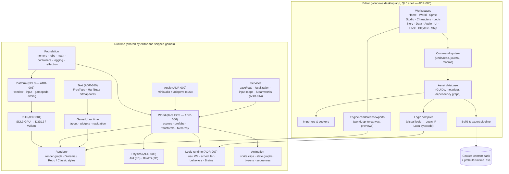
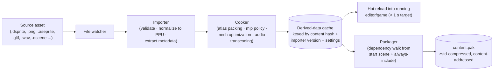
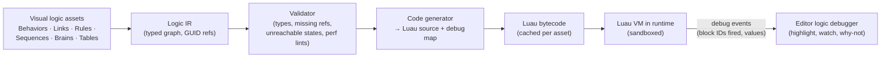
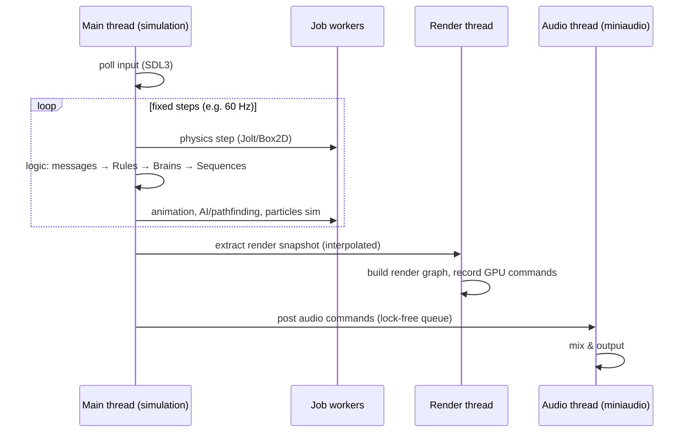
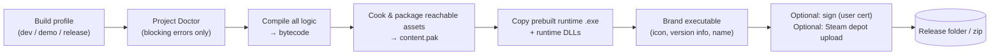

# Plan 03: Architecture

> How Sparxel is structured: runtime vs editor, modules, data flow, project format, asset
> pipeline, logic pipeline, threading, play-in-editor and export.
>
> Technology choices are justified in [`07-tech-stack-adrs.md`](07-tech-stack-adrs.md).
> This document refers to them by ADR number.

---

## 1. Guiding architectural principles

1. **Runtime and editor are separate products from one codebase.**
   - The *runtime* is what ships inside every game. It is small, fast and has no editor
     dependencies; in particular, no Qt.
   - The *editor* embeds the same runtime, so what you see is exactly what ships.
2. **Reflection drives everything.** Every component, behavior, action, condition and
   setting is declared once in C++ with metadata (name, category, tooltip, range, units,
   icon). The following are all **generated** from that declaration:
   - inspectors and serialization;
   - no-code logic blocks;
   - search;
   - documentation pages.

   This is the structural answer to lesson L1 in `research/04`. No engine feature is ever
   missing from the no-code vocabulary.
3. **Every edit is a Command.** All editor mutations go through one undoable,
   serializable command system. That gives universal undo, autosave journalling, macros,
   future collaboration, and a safe channel for any AI assistant (`06` §8).
4. **User content cannot crash the engine.** User logic runs in a sandboxed VM (ADR-007).
   Importers run with validation. A failure becomes a friendly error marker on the
   offending block or asset, not a crash.
5. **Open, text-based project data.** Scenes, prefabs, logic, tables and settings are JSON
   with stable GUIDs. They diff, merge and survive renames (ADR-011).
6. **Custom engine, not custom everything.** Proven permissively licensed libraries are
   used for platform, physics, audio, ECS, VM and text (ADR-000). Engineering effort goes
   where the product is unique: the HD-2D renderer, the no-code system, the authoring
   tools and the editor UX.

## 2. System overview



## 3. Module responsibilities

| Module | Responsibility | Key decisions |
|---|---|---|
| **Foundation** | Allocators, job system, math (SIMD), containers, string IDs, logging, asserts, **reflection registry** | Reflection metadata is the single source of truth for inspectors, logic blocks, docs and serialization |
| **Platform** | Window, input devices, gamepads, high-resolution timers, file system, Windows-specific integration (DPI, power, crash handler) | SDL3 (zlib licence [S66]) |
| **RHI** | A thin GPU abstraction: buffers, textures, pipelines, render passes, compute, synchronization | First backend on the SDL3 GPU API (D3D12 / Vulkan / Metal backends [S62]); native D3D12 backend as fallback (ADR-004) |
| **Renderer** | Render graph, scene extraction, the three Render Styles, post stack, debug views, GPU profiling | Specified in `04` |
| **World** | ECS world, scenes, prefabs with overrides, hierarchy, spatial queries, streaming | flecs: relationships, prefabs, reflection with JSON [S70] |
| **Physics** | 3D collision and character controllers for dioramas; 2D physics for side-view and Classic 2D | Jolt [S69] and Box2D v3 [S67] behind one "Collision" facade |
| **Audio** | Device output, mixing, buses, spatialization, streaming, adaptive music state machine | miniaudio [S72] |
| **Logic runtime** | Luau VM hosting, coroutine scheduler for Sequences, Brain (state machine) runner, Rules evaluation, message bus, timers | Luau [S71]; visual logic compiles to Luau bytecode (§6) |
| **Animation** | Sprite clip playback, directional selection, frame events, animation state graphs, tweens, Sequence timelines | Data-driven from Sprite Studio assets |
| **Game UI runtime** | Retained-mode UI tree, layout, styling, 9-slice, focus and navigation, text | Separate from the editor's UI toolkit |
| **Text** | Shaping and rasterization of TTF/OTF; bitmap pixel fonts | FreeType (FTL or GPLv2 [S80]) and HarfBuzz ("Old MIT" [S79]) |
| **Services** | Save and load, localization tables, input action maps, platform services (Steam) | Steamworks behind an interface (ADR-014) |

## 4. Project format (ADR-011)

```
MyGame/
├── project.sparxel.json         # project settings: name, PPU, render style, palette, version
├── assets/
│   ├── sprites/hero.dsprite      # layered pixel document (layers, frames, tags, slices, maps)
│   ├── sprites/hero.dsprite.meta # GUID, import settings, cached hashes
│   ├── tiles/forest.dtileset
│   ├── maps/village.dscene       # JSON scene: entities, components, prefab overrides
│   ├── prefabs/house_small.dprefab
│   ├── logic/village_rules.drules
│   ├── logic/guard.dbrain
│   ├── logic/intro.dsequence
│   ├── story/chapter1.dstory
│   ├── data/items.dtable
│   ├── audio/town_theme.ogg (+ .meta)
│   ├── ui/pause_menu.dui
│   └── looks/golden_hour.dlook
├── localization/strings.en.csv ...
├── .sparxel/                     # local caches; never committed (cooked data, thumbnails)
└── .git/ (optional)              # snapshots and history (ADR-012)
```

- **GUID references everywhere.** Paths are just for humans, so renaming or moving an asset
  never breaks a reference.
- **Text JSON for everything except pixel and audio payloads.** Pixel data inside
  `.dsprite` is stored in a compact chunk. The file's *structure* (layers, tags, slices)
  stays text, so it diffs meaningfully.
- **Format versioning.** Every file carries a schema version. The editor runs ordered
  migrations on load and never silently drops data.
- **Determinism.** Saving the same content twice gives byte-identical files (stable key
  ordering), which keeps diffs clean.

## 5. Asset pipeline



Key rules:

1. **Pixel art stays lossless.** Sprite and tile textures stay uncompressed RGBA8 on the GPU
   and are zstd-compressed only on disk. Block-compression formats would alter exact pixel
   colours. Non-pixel textures such as noise and LUTs may use BC formats.
2. **Atlas packing is automatic.** Users never manage sprite sheets. Atlases are rebuilt
   incrementally.
3. **PPU normalization happens at import.** Quads and meshes are scaled from the project
   PPU, and imported meshes whose texel density deviates beyond a threshold produce a
   Project Doctor warning (R-VIS-07).
4. **Cache keys are content-hash based,** so switching branches or restoring snapshots
   re-uses cooked data.
5. **Hot reload everywhere:** sprites, tiles, meshes, audio, tables, logic and Looks reload
   in the running game while state is preserved.

## 6. Logic pipeline (ADR-007)



- **The vocabulary** (actions, conditions, events, value getters) is C++ functions
  registered with reflection metadata. The generator emits calls into a bound API, so
  users never touch it directly.
- **Debug map:** every generated statement maps back to a block ID. That lets the editor
  highlight firing blocks, set breakpoints on blocks, and run the "why didn't this fire?"
  explainer, which re-evaluates each condition in the rule and reports the first false one
  with its live values.
- **Sequences** compile to Luau coroutines. "Wait for dialogue", "wait 1.5 s" and "wait
  until the player arrives" become yields managed by the scheduler. This gives RPG
  Maker-style sequential scripting (L4) without blocking the game.
- **Safety:**
  - The VM runs with Luau's sandboxing [S71] and per-frame execution budgets. The budgets
    rely on the VM's interrupt hooks, which the Phase 0 logic spike must validate.
  - Runaway loops are halted and reported on the offending block.
  - The bound API exposes no file system or network access.
- **The escape hatch:** optional Luau script blocks (E11) compile through the same path and
  are sandboxed the same way.

## 7. Frame and threading model



- **Fixed-timestep simulation** with interpolated rendering. This keeps behavior
  frame-rate-independent, makes physics stable, and enables deterministic **input replay**
  (N6).
- **The render thread** consumes an immutable snapshot, so simulation and rendering of
  consecutive frames overlap.
- **The job system** handles physics, animation, pathfinding, culling, particle simulation
  and asset streaming.
- **Determinism scope:** replays are deterministic on the same build and machine class.
  Cross-machine determinism is not promised for v1.0.

## 8. Play-in-editor (PIE)

- **In-process, isolated world.** Pressing Play clones the edited scene into a separate
  ECS world with its own logic VM state, which takes seconds or less. Stopping discards the
  play world, so editor data is never mutated by gameplay.
- **Live edit while playing.** Edits during play are applied to *both* the edit world
  (persistently) and the play world (live) where that is safe. Examples include art, Look
  settings, table values and logic changes. Structural changes that cannot be hot-applied
  prompt a quick restart from the current position.
- **The standalone test** (N7) launches the real runtime executable against the cooked
  content. This is the final "exactly like shipping" check.

## 9. Build and export pipeline



- **No compiler on the user's machine.** The runtime ships prebuilt inside the editor, and
  user logic is bytecode. Exporting is packaging. This is essential for non-coders: no
  Visual Studio installation, ever.
- **Executable branding** uses Windows resource updating to set icon and version info,
  then optional Authenticode signing with the user's own certificate (O6).
- **Reproducible builds:** the same project at the same version gives the same content
  hash.

## 10. Save-game architecture

- Persistence is **declarative**. Variables and entity properties marked *persistent* are
  collected automatically by a save schema generated from reflection.
- Save files are **versioned**. A game update can define migration steps, as a no-code
  "When loading a save from version < X, do ..." rule (M3).
- Writes are crash-safe: write to a temporary file, flush, then rename atomically.
  Steam Cloud integration hooks in at the file layer (M4).

## 11. Extensibility layers

| Layer | Who | How | Tag |
|---|---|---|---|
| Custom Blocks | Everyone | Package visual logic as a new action, condition or behavior with parameters | 1.0 |
| Luau packages | Power users | New blocks, behaviors and importers, sandboxed | 1.0 |
| C++ plugins | Professional teams | Stable C ABI. Runtime modules and editor panels | Post |

## 12. Cross-cutting concerns

- **Error handling:** user-facing errors are always actionable ("The door 'North Gate'
  links to a map that was deleted. **Pick a new map** / **Remove link**"). Raw stack
  traces are never shown to users. They go to logs and the opt-in crash reporter.
- **Telemetry:** strictly opt-in. Covers crash and stability only, unless the user consents
  to usage analytics. No project content is ever uploaded.
- **Security:** imported projects and mods run only sandboxed Luau, with no native code.
  Untrusted file importers are hardened and fuzz-tested (`09` §2).
- **Performance budgets:** enforced in CI on reference hardware, both for the runtime
  (`04` §11) and the editor (`06` §7: startup, project open, PIE start, hot reload).
