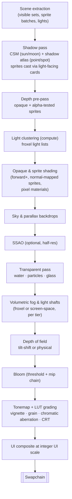

# Plan 04: Rendering Pipeline

> The renderer that delivers the HD-2D-style look out of the box. It implements
> requirements R-VIS-01 to R-VIS-18 from
> [`../research/01-hd2d-visual-language.md`](../research/01-hd2d-visual-language.md).
>
> Unless a statement cites a source `[S#]`, this document is design, not reported fact.
> Every technique below must be proven in the Phase 0 rendering spike (`08`) before the
> design is frozen.

---

## 1. Goals

1. **Beautiful by default.** A new Diorama-style project shows lit pixel-art sprites in a
   3D diorama with depth of field, bloom and fog. No user setup is needed.
2. **One pipeline, three Render Styles.** Diorama, Retro 3D and Classic 2D share passes,
   materials and tools (R-VIS-01).
3. **Pixel integrity.** Consistent texel density, no unintended blur, and no shimmer
   (R-VIS-07, R-VIS-08).
4. **Predictable performance.** Every pass has a budget, quality tiers scale it, and
   automated tests enforce it (R-VIS-14).

## 2. Units and scale

- **PPU (pixels per unit)** is a project setting. The default is 16, so 1 world unit equals
  one 16×16 tile. The allowed range is 8 to 64.
- A sprite's world size is its pixel size divided by the PPU. Users never type sizes for
  sprites.
- World textures should match the same PPU. The **texel-density view** (§10) colours
  surfaces green (matched), yellow (±25%) or red (worse).

## 3. Render Styles at a glance

| Aspect | **Diorama** (HD-2D style) | **Retro 3D** | **Classic 2D** |
|---|---|---|---|
| Scene | 3D world + billboard sprites | 3D world + billboard sprites | 2D layers + sprites |
| Camera | Perspective (default narrow FOV) or orthographic | Orthographic (perspective "experimental") | Orthographic 2D |
| Internal resolution | Output resolution × render scale | Fixed low resolution (e.g. 320×180, 480×270, 640×360) | Fixed base resolution |
| Upscale | Optional temporal or spatial upscaler at < 1.0 render scale | **Integer** upscale + optional sub-pixel scroll | **Integer** upscale (pixel-perfect camera) |
| Pixel stability | Texture-space pixels, crisp-AA filtering (§6.2) | Camera and object snapping to the low-resolution grid [S19] | Pixel-snapped camera |
| Lighting | Full 3D clustered lighting + shadows | Same as Diorama, at low resolution | 2D lights with normal and mask maps (model like Unity URP 2D [S26]) |
| Post stack | Full | Full or reduced (style choice) | Full or reduced |

## 4. Frame structure (Diorama style)

**Why clustered forward+ and not deferred**
- HD-2D scenes contain many small dynamic lights: torches, magic, windows at night.
  Clustered lists keep their cost bounded.
- Forward shading handles the variety of sprite and pixel materials (palette swap,
  dissolve, flash, outline) and transparencies without a fat G-buffer.
- This choice is to be confirmed in the Phase 0 spike by measuring both options on the
  reference scene.

## 5. Sprites in 3D

### 5.1 Billboard modes (R-VIS-02)

| Mode | Behavior | Typical use |
|---|---|---|
| **Upright** (default) | Rotates around the world Y axis to face the camera; stays vertical | Characters, NPCs, trees |
| **Full** | Always faces the camera plane | Particles, pickups, magic |
| **Fixed** | No rotation; placed like a card | Signs, posters, fences seen side-on |
| **Ground** | Lies flat on the surface below | Shadows, decals, puddles, floor runes |

**Directional sets (1, 2, 4 or 8 directions).**
- The frame is selected from the angle between the entity's facing and the camera's yaw,
  with hysteresis to avoid flicker at boundaries.
- Mirrored directions are generated automatically when the artist allows it.

**Camera limits.** Each camera rig defines yaw and pitch limits. The editor shows a warning
cone when an orbit exceeds the range in which billboards read well (R-VIS-10).

### 5.2 Depth and integration (R-VIS-09)
- Sprites are **alpha-tested** (cut-out) by default and **write depth**. Depth of field,
  fog, SSAO and shadows therefore treat them like geometry.
- **Pivot at the feet.** Ground snapping uses the collision surface, so characters stand
  on slopes and stairs correctly.
- **Depth offset** is a per-sprite slider that pushes depth toward the camera, so sprites
  standing against walls do not clip into them.
- **Optional sprite depth map** for self-occlusion of large sprites, such as a tree canopy
  over a character.

### 5.3 Lighting model for sprites (R-VIS-03, R-VIS-15)
- Inputs: albedo; a **normal map** (generated or painted in Sprite Studio); an emissive
  mask; an optional specular/roughness mask.
- **Wrap diffuse lighting** with a controllable wrap factor. This softens the terminator,
  which suits pixel art.
- **Rim light**, optional, either per sprite or from the Look.
- **Ambient** from the Look's sky and ground colours, or from light probes (1.0).
- **Palette-locked mode** (Post, R-VIS-18): the final lit colour is snapped to the nearest
  colour in the sprite's palette ramp, which preserves a hand-shaded look under dynamic
  light.

### 5.4 Sprite shadows (R-VIS-03)

| Mode | How | Cost |
|---|---|---|
| **Silhouette** (default) | In the shadow pass, the sprite's alpha-tested card is re-oriented to face the *light*, so the silhouette never collapses to a sliver | Low |
| **Blob** | Soft ellipse decal under the pivot, scaled by height above ground | Very low |
| **None** | No shadow | none |

### 5.5 Batching
- Sprites share atlases, which are automatic (`03` §5). They render in instanced batches
  sorted by material, keeping draw calls low even with hundreds of NPCs and props.

## 6. World materials

### 6.1 Layer-based materials (D13)
A material is a **stack of layers**, not a node graph:
- a base pixel texture;
- optional normal, emissive and specular layers;
- effect layers: UV scroll, wind sway, flash, dissolve, outline, palette swap, water ripple.

Each stack compiles to a shader permutation. A node graph for technical artists comes after
1.0 (D15).

### 6.2 Texture filtering modes (R-VIS-08)

| Mode | Behavior | Default for |
|---|---|---|
| **Nearest** | Pure point sampling | Retro 3D, Classic 2D |
| **Crisp-AA** | Point sampling inside each texel, with a narrow screen-space-width blend across texel edges. Pixels stay sharp but shimmer is removed when textures are minified, rotated or moving under perspective | **Diorama** |
| **Bilinear** | Smooth sampling | Non-pixel assets (gradients, noise, some UI) |

**Mipmaps** for pixel textures use area or nearest downsampling, never blurry box filters.
Ground surfaces use anisotropic filtering at grazing angles.

## 7. Lighting, shadows and atmosphere

| Feature | Design |
|---|---|
| Light types | Directional (sun/moon), point, spot, area (rect/disc approximations) |
| Shadows | Cascaded shadow maps for the sun/moon (2–4 cascades by tier). A shadow atlas for up to N shadowed local lights (4/8/16 by tier); unshadowed lights are unlimited within cluster limits |
| Light presets | Torch flicker, candle, magic pulse, lightning flash, window glow |
| Time of day (D5) | Sun and moon paths, sky gradient, ambient ramp, fog colour ramp, Look blending on a schedule. Driven by a game-time variable that logic can control |
| Weather (C9) | Rain, snow, fog banks, wind, wet-surface darkening; pixel particle presets |
| Baked lighting (D17, 1.0) | Optional bake of static lights to lightmaps and probes for rich, cheap static scenes |

## 8. Post-processing stack and Looks

### 8.1 Effects (R-VIS-05)

| Effect | Key parameters | Notes |
|---|---|---|
| **Depth of field: tilt-shift** | Focus band centre and height (screen space), blur strength, falloff | The signature "miniature diorama" look. Default on in Diorama Looks |
| **Depth of field: physical** | Focus distance (auto-focus on the player or a target), aperture, bokeh size | Used for cutscenes and close-ups |
| **Bloom** | Threshold, intensity, radius, tint | Mip-chain bloom; emissive masks drive the glow |
| **Fog** | Distance and height fog, colour from the Look, sky blend | |
| **Volumetric light** | Froxel volume (High/Ultra) or screen-space shafts (Low/Medium) | God rays through windows and trees |
| **SSAO** | Radius, intensity, half resolution | Off on Low |
| **Colour grading** | LUT (authored from presets or imported), exposure, saturation, contrast | Guardrail: a saturation histogram warns on extreme values (`research/01` §4) |
| **Lens and screen** | Vignette, grain, chromatic aberration, CRT and scanline filter | All optional |

### 8.2 Looks (R-VIS-06)
- A **Look** asset bundles post settings, fog, ambient light, sky and grading.
- Looks **blend** by zone (walking into a cave) and by time of day (dusk → night).
- Sparxel ships with tuned presets, for example: *Golden Hour Village*, *Moonlit Forest*,
  *Torch-lit Dungeon*, *Overcast Coast*, *Desert Noon*, *Snowfield*, *Interior Warm*,
  *Battle Dramatic*. Each was created by an artist to keep the pixel-art balance
  (`research/01` §4).

## 9. Retro 3D and Classic 2D specifics

### Retro 3D (R-VIS-12)
- The scene renders to a fixed low-resolution target, then is **integer-upscaled** to the
  window, with letterboxing when needed.
- Camera and moving objects **snap** to the low-resolution pixel grid to remove pixel creep.
  This is only fully solvable with orthographic projection [S19].
- **Smooth scrolling** option: render a one-pixel margin and apply the sub-pixel camera
  remainder as an offset during upscaling.
- Perspective mode is "experimental". Perspective-stable techniques such as texel splatting
  [S20] are a research item; the paper itself lists disocclusion as an open trade-off.

### Classic 2D
- A pixel-perfect orthographic camera with integer scaling.
- 2D lights (point, spot, global) that sample sprite normal and mask maps, plus per-sprite
  2D shadow casters. The model is similar to Unity's URP 2D lights and Shadow Caster 2D
  [S26].
- Parallax layers, the same Look and post stack, and the same particle system.

## 10. Debug views (editor and Playtest)

| View | Shows |
|---|---|
| Texel density | Green, yellow or red per surface against the PPU (R-VIS-07) |
| Lighting only / albedo only / normals | Isolates sprite and material inputs |
| Light complexity | Lights per cluster, as a heatmap |
| Overdraw | Particle and transparency cost |
| Shadow cascades / atlas | Shadow resolution distribution |
| Depth / focus | Depth-of-field focus band and blur radius |
| GPU timings | Per-pass time against budget (plain-language summary in the Playtest overlay) |

## 11. Performance budgets (initial, to be validated)

Target: **60 fps at 1920×1080, Medium tier, on the reference minimum-spec PC** (ADR-001).
That gives a total frame budget of 16.6 ms, with about 14 ms allotted to the GPU.

| Pass | Budget (ms) |
|---|---|
| Shadows | 2.0 |
| Depth pre-pass | 0.8 |
| Opaque + sprites | 3.5 |
| Sky and parallax | 0.3 |
| SSAO | 1.0 |
| Transparent + particles | 1.5 |
| Volumetrics and fog | 1.5 |
| Depth of field | 1.5 |
| Bloom | 0.8 |
| Tonemap, grading, final | 0.5 |
| UI | 0.5 |
| **Headroom** | **~2.7** |

**Quality tiers**
- Low, Medium, High and Ultra scale shadow resolution, cascade count, volumetric technique,
  SSAO and DoF sample counts, and the internal render scale.
- Tiers are auto-detected on first launch, and players can override them.
- Game creators choose which settings are exposed to players in the options menu template.

## 12. Shader pipeline (ADR-015)
- Shaders are authored in **HLSL** and compiled offline. Permutations come from material
  layer stacks and feature flags.
- Shaders reach the RHI through **SDL_shadercross**, which accepts HLSL or SPIR-V and emits
  shaders for every backend the SDL GPU API implements [S64]. A native D3D12 backend
  consumes DXIL directly.
- Pipeline objects are cached on disk to avoid hitches. Shipped games include a
  pre-warmed pipeline cache built during export.

## 13. Verification
- **Golden-image tests:** reference scenes for each Render Style and Look are rendered
  headless in CI and compared with perceptual tolerances. Any visual change needs
  approval.
- **Performance tests:** reference scenes run on dedicated reference hardware nightly,
  with per-pass budgets as pass/fail thresholds.
- **Art-direction review:** a technical artist signs off every Look preset against the
  checklist in `research/01` §4.
