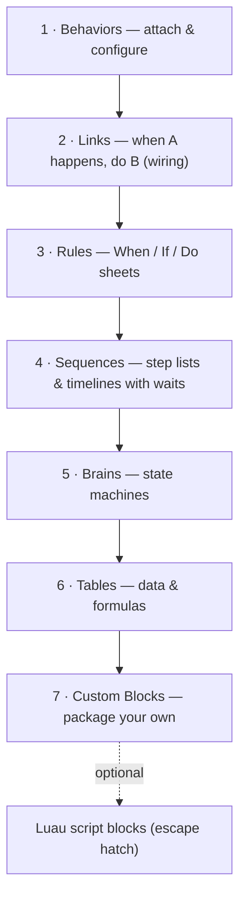

# Plan 05: The No-Code Logic System

> How non-coders build complete game logic in Sparxel. This implements the conclusions of
> [`../research/04-no-code-paradigms.md`](../research/04-no-code-paradigms.md):
> lessons L1–L10.
>
> This is the most important document in the plan. If this system is not easy *and*
> powerful, the product fails, regardless of how good the renderer is.

---

## 1. Design goals

1. **No code, ever, for any 1.0 genre kit feature.** Everything in `02` is buildable
   without typing a script.
2. **The right tool per task.** Each kind of logic gets the representation that fits it
   naturally (`research/04` §2).
3. **One shared vocabulary.** The same events, conditions, actions and values appear in
   every layer. Learn a block once, use it everywhere.
4. **Impossible to make syntax errors.** Editing is structural, with typed slots and
   pickers.
5. **Visible execution.** Users can *see* what fires and *why* something did not.
6. **Scales to a 20-hour RPG.** Search, references, reuse and organization tools are
   built in from the start.

## 2. The shared vocabulary

| Concept | Plain-language meaning | Examples |
|---|---|---|
| **Event** | "When something happens" | *Game starts · Player presses Interact · Touched by Player · Variable changes · Timer finishes · Message received · HP reaches 0 · Enters Region · Day becomes Night* |
| **Condition** | "Only if this is true" | *Player has item [Key] · Quest [Lost Cat] is at stage 2 · Random chance 25% · Is facing Player · Time is Night* |
| **Action** | "Do this" | *Open door · Show dialogue · Give item · Play sound · Move to · Spawn · Set variable · Change map · Shake camera · Start battle* |
| **Value** | A number, text, yes/no, colour, position, object, asset… | *Player's HP · Max HP × 0.25 · "Hello" · Position of [Signpost]* |
| **Who** (targeting) | Which objects an action affects | *This object · The Player · The other object (the one that touched) · All objects tagged [Enemy] · The ones matched by the condition above* |

**Types** are visible as shape and colour plus an icon, never colour alone (R3):

- Number, Whole number, Yes/No, Text
- Colour, Position, Direction, Time (seconds)
- Object, Asset (Map, Sprite, Sound, Sequence, Table row)
- List

**Units** are first-class. "Move 3 tiles" and "Wait 0.5 seconds" are written that way, and
conversions are automatic.

**Generated from reflection.** Every block comes from engine metadata (`03` §1.2). That
metadata provides its icon, category, tooltip, parameters with defaults and ranges, and
documentation link. New engine features appear in the vocabulary automatically.

## 3. The seven layers



The layers are ordered by how often a typical user needs them. Most objects in most games
need only layers 1 and 2.

### 3.1 Behaviors (layer 1): "attach a capability"
- In the inspector, **Add Behavior** opens a searchable, categorized gallery with an
  animated preview of each behavior.
- Every behavior has sensible defaults. Options are grouped into **Basic** and
  **Advanced** (progressive disclosure).
- **Starter behaviors:**
  - *Movement:* Top-down Mover, Grid Mover, Platformer Controller, Follow Path, Wander.
  - *Interaction:* Talkable, Chest, Door to Map, Pushable, Pickup, Save Point, Shop
    Keeper.
  - *Combat:* Health, Damage on Touch, Projectile, Knockback.
  - *Presentation:* Bob and Sway, Flicker Light, Look-at-Player, Fade on Approach.
  - *Utility:* Spawner, Timer, Trigger Region, Counter.
- Behaviors **expose events and actions** to the other layers. For example, *Chest* exposes
  the event *Opened* and the actions *Open* and *Lock*.

### 3.2 Links (layer 2): "when this happens, do that"
- **Purpose:** level scripting through wiring. This follows the UEFN direct event binding
  pattern [S59], in which one device's event calls another device's function.
- **UI:**
  - In the World view, drag from an object's **event port** onto another object, then pick
    the action.
  - Links are drawn as curved lines in the viewport, and can be filtered or hidden.
  - Each link can have an optional **delay** and an optional **"only if"** condition.
- **Examples:**
  - `Lever → Switched On → Gate: Open`
  - `Pressure Plate → Pressed → Spike Trap: Disable`
  - `Boss → Defeated → Exit Door: Unlock` with a delay of 1 s
- **Limits:** Links are one-step reactions. Anything needing multiple steps escalates
  naturally: one click turns a Link into a Rule or Sequence that the user can extend.

### 3.3 Rules (layer 3): event sheets
- **Structure:** each row is **When** (one event) → **If** (zero or more conditions) →
  **Do** (actions). Rules can contain sub-rules, **Otherwise** (else), **For each** and
  **Repeat**, and can be organized into named **groups** that are enabled or disabled
  together.
- **Scopes:**
  - **Object rules** live on a character or prefab.
  - **Map rules** live on a scene.
  - **Global rules** apply across the game.

  The editor always shows which scope you are in.
- **Per-frame evaluation is never implicit.** This addresses the GDevelop pitfall noted in
  `research/04` [S32]:
  - The event *Continuously (every frame)* has to be chosen explicitly.
  - It carries a cost badge.
  - Project Doctor lists continuous rules that could be event-driven instead.
- **"Who" picking is shown in plain language.** For example: *"Do these actions on: the
  Enemies that are within 3 tiles of the Player"*. Picking is never an invisible side
  effect.
- **Order:** rules run top to bottom within a scope. Scopes run in a fixed order: global,
  then map, then object (§5). Each rule shows its execution number while debugging.

### 3.4 Sequences (layer 4): cutscenes and multi-step scripts
- **Purpose:** anything sequential with **waits** (L4), such as NPC conversations,
  cutscenes, puzzles and scripted events.
- **List view** (default): steps read like a script. For example:
  1. *Show dialogue* "Elder: You're finally awake…" **and wait**
  2. *Choice:* "Who are you?" / "Where am I?" → branches
  3. *Move* Elder **to** [Altar] **and wait**
  4. *Camera:* pan to [Altar] over 2 s
  5. *Play sound* [Chime]; *Give item* [Old Key]
  6. *Set* quest [Awakening] **to stage** 2
- **Timeline view:** for synchronized cutscenes. Tracks for camera, characters, animation,
  audio, Look and dialogue, with keyframes and scrubbing.
- **Run mode:**
  - **Cutscene** pauses player control, like RPG Maker's Autorun [S37].
  - **Background** runs while play continues, like Parallel [S36][S37].
  - The mode is chosen explicitly when a Sequence is started.
- **Composability:** a Sequence can call another, run steps **in parallel**, and **wait for
  events**, for example "until the player enters [Region]".
- **Implementation:** Sequences compile to Luau coroutines. Waits are yields (`03` §6).

### 3.5 Brains (layer 5): state machines
- **Purpose:** characters, enemy AI, bosses, game flow (title → playing → paused → game
  over) and animation selection.
- **States** contain **On Enter**, **While In** and **On Exit** sections. Each section uses
  steps (Sequence-style) or rules.
- **Transitions** have conditions and priorities, an optional minimum time in state, and
  "from any state" transitions such as *HP ≤ 0 → Dead*.
- **Hierarchical states** keep large AIs readable. For example, a *Combat* state can
  contain *Approach*, *Attack* and *Recover*.
- **Templates:**
  - Enemy: *Patrol → Chase → Attack → Return*; *Ranged Kiter*; *Ambusher*.
  - Boss: phase changes.
  - NPC: daily schedule.
- **The animation state graph** is a specialised Brain whose states play animation clips.
  Transitions read movement and combat state. This removes the need for a plugin like
  PaperZD [S28].
- **Staging:** the alpha ships Brains as ready-made templates whose options are tuned in
  the inspector, including a standard character animation graph. The editor for building
  and changing Brains arrives at 1.0 (`02`, E5).
- **Live view:** in Playtest, the active state glows, and transitions flash when taken.

### 3.6 Tables (layer 6): data and formulas
- **Typed Data Tables:** Items, Skills, Enemies, Loot Drops, Shops, Classes, Status
  Effects, or any custom table.
- **Columns have types**, including references to other tables or assets, for example an
  Enemy's *Drop Table* or an Item's *Icon*.
- **Formula columns** work like spreadsheet formulas, built with pickers or typed with
  autocomplete, and are validated with units. For example:
  `Damage = (Attacker.Attack × Skill.Power ÷ 100) − Defender.Defense × 0.5, minimum 1`
- **Curves:** XP to next level, enemy scaling and price growth. These are edited as graphs
  or as formulas.
- **In logic:** *Get [Power] of [Skills: Fireball]*, *For each row in [Shop: Village
  Shop]*, *Pick random row from [Loot: Slime Drops] weighted by [Chance]*.
- **Balancing charts** (T4) and CSV round-trip (T5).

### 3.7 Custom Blocks (layer 7): make your own
- Select logic in any layer, then choose **Make Block**. The user gives it a name, an
  icon, parameters (typed, with defaults) and optional outputs.
- The new block appears in the library next to built-in blocks, with an auto-generated
  documentation page.
- **Custom Behaviors** bundle events, actions, properties and internal logic into an
  attachable behavior. This is how kits are built (L2).
- Blocks are **versioned**. Changing a block's parameters shows every usage and offers
  fixes.

### 3.8 Escape hatch: optional Luau (E11)
- A **Script** block has typed inputs and outputs and a Luau body, and runs sandboxed
  [S71].
- Power users can define new blocks and behaviors in Luau. Non-coders can use those blocks
  without ever seeing the code.
- **Guardrail:** no built-in kit or template may depend on Script blocks. The vertical
  slice must ship with zero script (`01` §6).

## 4. Expressions without code
- **Structured editing:** a value slot accepts a constant, a picker (*Player → HP*) or a
  formula built from blocks.
- **Plain-language rendering:** formulas display as readable sentences when collapsed. For
  example: *"Player's HP is below 25% of Player's Max HP"*.
- **Typing is allowed** with autocomplete, but the result is parsed into the same
  structure. Invalid input is highlighted in place with a suggestion. A program that
  cannot run can never be saved silently.
- **Units and types are checked live.** For example, "You're comparing a Time (seconds)
  with a Distance (tiles)."

## 5. Execution model

Per fixed simulation step (`03` §7):

```
1. Input actions sampled
2. Physics step → collision / region / trigger events queued
3. Event dispatch (in queue order):
     Links fire → Rules with matching "When" run (global → map → object scope; top → bottom)
4. Brains evaluate transitions (highest priority first), run On Exit / On Enter
5. Sequences resume (coroutines whose wait condition is satisfied), in start order
6. "Continuously" rules run
7. Messages sent during this step are delivered at the start of the next step
8. Animation & presentation update
```

- **Deterministic ordering** makes behavior explainable and replayable (N6).
- **Messages are deferred** one step, which prevents infinite same-frame ping-pong. A
  message *can* be marked "deliver now" for advanced cases. Such messages are depth-limited
  and flagged in Project Doctor.
- **Budgets:** per-frame execution budgets for the logic VM. If exceeded, the culprit block
  is reported and the game continues (`03` §6).

## 6. Understanding and debugging logic

| Tool | What it does |
|---|---|
| **Live highlight** | During play, rules, links, sequence steps and Brain states glow when they run |
| **Watches** | Pin any variable, property or table value; see it update live |
| **Breakpoints** | Click any block to pause the game when it runs. Step forward one block or one frame |
| **"Why didn't this fire?"** | Select a rule or link. The debugger re-evaluates its conditions with live values and reports, in plain language, the first one that failed: *"Player has item [Key]: **No**, the Player's inventory has 0 Keys."* |
| **Event log** | A plain-language timeline, for example *"12.4 s · Player touched Chest #3 → Rule 'Open chest' ran → Gave item Potion"* |
| **Logic map** | A graph of who talks to whom: links, messages and sequence calls, scoped to a map or the whole game |
| **Find usages** | For any variable, item, quest, sequence or block |
| **Project Doctor lints** | Unused variables, unreachable states, links to deleted objects, continuous rules, sequences that never end, missing localization |

## 7. Safety
- **References are GUIDs.** Renaming anything updates every usage automatically.
- **Deleting** something that is referenced shows its usages and offers *Replace with…*,
  *Remove usages* or *Cancel*.
- **Infinite loops and runaway recursion** are stopped by budgets and reported on the
  block. The editor never freezes.
- **Every edit is an undoable Command.** That includes edits made by the optional AI
  assistant (`06` §8).

## 8. Vocabulary catalogue (initial categories)

| Category | Example events | Example conditions | Example actions |
|---|---|---|---|
| Game and flow | Game starts, Map loaded, Paused | Is in cutscene, Difficulty is | Change map, Save, Load, Quit to title |
| Input | Action pressed, released or held | Is action held | Rumble, Show input prompt |
| Objects | Created, Destroyed, Clicked | Exists, Is visible, Has tag | Spawn, Destroy, Show/Hide, Set property |
| Movement | Arrived, Blocked | Is moving, Is on ground, Distance to | Move to, Move by, Follow, Face, Jump, Teleport |
| Collision and regions | Touched, Entered region, Exited region | Is overlapping, Line of sight to | Enable/disable collision |
| Animation | Clip finished, Frame event | Is playing clip | Play clip, Set direction, Flash, Shake |
| Combat | Damaged, HP reaches 0, Hit landed | HP below, Has status | Deal damage, Heal, Apply status, Knockback |
| Inventory and economy | Item gained | Has item (count) | Give, Take, Open shop, Add gold |
| Dialogue and story | Choice made, Dialogue ended | Quest at stage, Has talked to | Show dialogue, Start quest, Set stage |
| Camera and Look | Camera arrived | — | Pan, Zoom, Shake, Set Look, Fade, Set time of day |
| Audio | Music beat, Sound finished | Is music playing | Play sound, Play/Crossfade music, Set bus volume |
| UI | Button pressed, Menu closed | Menu is open | Open menu, Update text, Show notification |
| Variables and data | Variable changed | Compare value, Random chance | Set, Add, Toggle, Read table row |
| Time | Timer finished, Day/night changed | Time of day is | Start timer, Wait (in Sequences) |
| Platform | Achievement unlocked | Is Steam running | Unlock achievement, Set stat, Upload score |

## 9. Worked examples

### 9.1 A lever opens a gate (Links only)
1. Place a **Lever** (behavior: *Switch*) and a **Gate** (behavior: *Door*).
2. Drag from the Lever's **Switched On** port to the Gate, then choose **Open**.

That is all. No sheet and no script.

### 9.2 A chest that needs a key (Behavior + one Rule)
- The Chest has the behavior **Chest** (contents: *Potion ×2*, locked: yes).
- Object rule:

  | When | If | Do |
  |---|---|---|
  | Player interacts with **this** | Player has item **Rusty Key** | Take item Rusty Key · **Unlock** this · **Open** this |
  | *Otherwise* | | Show dialogue "It's locked." |

### 9.3 The village elder's introduction (Sequence)
- An NPC **Elder** with the behavior *Talkable*. Its "on talk" option is set to the
  Sequence **Elder Intro**, which runs in Cutscene mode.
- **Elder Intro** contains: dialogue with a choice → camera pan → give item → set quest
  stage → *If* the quest is already done, show the alternative line instead.

### 9.4 A goblin that patrols, chases and attacks (Brain from a template)
- Add the behavior **Enemy AI**, then choose the template *Patrol → Chase → Attack →
  Return*.
- Tune it in the inspector: sight range 6 tiles, attack range 1 tile, patrol path [Path A].
- To customise (1.0, Brain editor), open the Brain and add a state **Flee** with the
  transition *HP below 20%*.

### 9.5 Fire damage formula (Table)
- In table **Skills**, the row **Fireball** has Power = 120, Element = Fire.
- The battle kit's damage formula column already uses
  `Power × Attacker.Magic ÷ 100 × ElementMultiplier(Defender, Element)`.
- Balancing chart: plot Fireball damage against enemy levels 1–30.

## 10. Validation plan (logic-specific)
Run at the Phase 2, 3 and 4 gates with five to eight non-programmers per round (`09` §3):

1. **Tasks:**
   - lever and door;
   - locked chest;
   - NPC with choice;
   - a 5-step cutscene;
   - enemy patrol → chase;
   - a shop;
   - a quest with two stages;
   - a damage tweak;
   - save point;
   - "fix this broken rule" (uses the debugger).
2. **Measures:** unassisted completion rate (target ≥ 80%), time on task, number of
   "programmer explanations" needed (target 0), and SUS (target ≥ 75).
3. **Every failure** produces either a vocabulary change, a new preset, or a UX fix before
   the next gate.
