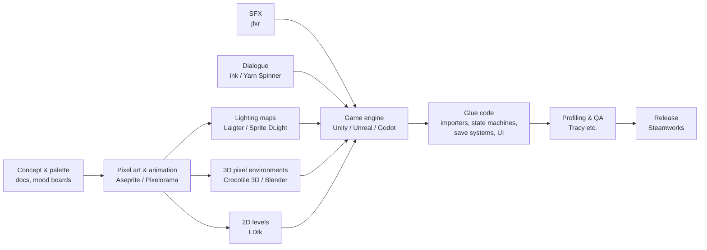

# Research 03: Content Tools and Production Workflows

> **What this document answers:** what a pixel and HD-2D game production looks like from
> start to finish today, which specialised tools teams use at each stage, where the
> workflow hurts, and how an all-in-one engine should absorb each stage.
>
> `[S#]` refers to [`../sources.md`](../sources.md). Sections labelled **Analysis** are the
> author's assessment.

---

## 1. Today's workflow: many tools, many hand-offs

A typical indie pixel or HD-2D project today chains many separate tools. Every arrow in the
diagram below is a file export and re-import, which is a place where scale, palette or
naming can drift. The tool names are representative examples cited in this document.

**Analysis: the pain points**

| # | Pain point | Who it hurts most |
|---|---|---|
| P1 | **Round-trip friction.** Edit in tool A, export, re-import into the engine, find a problem, repeat. | Everyone; worst for artists. |
| P2 | **Scale and palette drift.** Each tool has its own idea of pixel size, origin and pivot, and colour management. | HD-2D projects, where texel density must match (`research/01` §6.1). |
| P3 | **Glue code.** Importers, animation state wiring, save systems and menus all need programming in a general engine. | Non-coders, who are completely blocked here. |
| P4 | **A licence patchwork.** Each tool has different terms (see below). | Small teams without legal help. |
| P5 | **Binary assets in version control.** Images and audio do not diff or merge. | Teams of two or more. |
| P6 | **Late discovery of shipping work.** Store integration, achievements, cloud saves and crash handling get left to the end. | First-time shippers. |

## 2. Each stage in detail

### 2.1 Pixel art and sprite animation
- **Aseprite** [S45][S46]
  - A commercial pixel-art and animation editor, sold on Steam and itch.io [S45].
  - Features include tilemap and tileset modes, real-time animation preview and onion
    skinning, Pixel Perfect mode, shading ink, custom brushes and Lua scripting [S45].
  - **Licence:** since v1.1.8 (August 2016) the source and official binaries are under an
    EULA. That makes it source-available, not open source. The free fork **LibreSprite**
    was created after the change [S45].
  - **File format:** the `.ase`/`.aseprite` format is publicly documented. It covers
    layers (normal, group and tilemap), cels, **tags** (named frame ranges with loop
    direction and repeat count), palettes, **slices** (with 9-patch centres and pivots),
    tilesets and typed user data [S46].
- **Pixelorama** [S47]
  - An **MIT-licensed** editor built with **Godot**.
  - Animation: a timeline with onion skinning, frame tags and audio sync.
  - Tilemap layers support rectangular, isometric and hexagonal tiles.
  - It can place 3D models and shapes onto the 2D canvas.
  - Export: PNG, animated PNG, spritesheets, GIF and video.

**Analysis: our approach**
- Build a **Sprite Studio** into the engine that covers the core of these editors:
  - drawing tools, layers, palettes and ramps;
  - animation with tags, onion skinning and per-frame events;
  - slices, pivots and 9-patch;
  - tile mode.
- Also **import `.aseprite` files natively with live reload**, using the public spec [S46].
  Professional artists can keep Aseprite while non-artists never need it. Tags become
  animation clips, slices become 9-slice and pivot data, and user data becomes custom
  properties.

### 2.2 Lighting maps for sprites
- **Laigter** is **GPLv3** open source. It generates normal, specular, occlusion and
  parallax maps from 2D textures, with a live lighting preview [S48].
- **Sprite DLight** generates normal, depth, ambient-occlusion and specular maps from
  existing sprites [S49].
- **The quality caveat:**
  - The Cryptark team used Sprite Lamp, and the result looked "too flat" with a
    "plastic wrap" effect [S50].
  - A 2022 study notes that normal-map methods built for 3D games may give poor results on
    pixel art [S83].
- **How engines consume these maps:** Unity's URP 2D lights use normal and mask textures
  linked to sprites [S26].

**Analysis: our approach**
- Normal-map generation and *painting* live inside Sprite Studio.
- The artist always sees the result under the game's actual lights.
- Generation presets are tuned for pixel art.
- No external tool and no export step.

### 2.3 3D pixel environments (the HD-2D world)
- **Crocotile 3D** [S51][S52]
  - Builds 3D scenes by placing tiles from a pixel-art tileset onto 3D geometry. The
    Steam listing calls it a tool for low-poly models and scenes with pixel-art textures.
  - First released in 2015. Version 2.4.5 (late 2024) added bones, skinning and vertex
    weights.
  - Exports to Godot and Unity. Listed at US$29.99 on Steam.
- **Blender** is the general-purpose alternative: a full 3D suite rather than a dedicated
  pixel-art tool.

**Analysis: our approach**
- This is the most important authoring tool for the HD-2D look. The **Diorama Builder**
  (`plan/02` §C) builds the world *inside the engine* with:
  - Crocotile-style tile painting onto 3D faces;
  - block, slope and stair brushes;
  - prefab kits;
  - auto-tiling rules.
- glTF 2.0 import covers models from Blender and other tools that export glTF.

### 2.4 2D level design
- **LDtk** (Level Designer Toolkit, by Deepnight Games) [S53]
  - **MIT-licensed.**
  - **Auto-layer rules** paint visual tiles automatically from a collision or IntGrid layer.
    Version 1.2.0 added an assistant that builds standard auto-tile rules, and 0.9.0 added
    optional "biome" rule groups.
  - **Entities** have typed custom fields. Version 1.1.0 added **references** between
    entities, so a button can point at a door.
  - A "Super Simple export" writes PNGs per layer plus JSON entity data.

**Analysis: our approach**
- Adopt LDtk's best ideas natively: rule-based auto-tiling, typed entity fields and
  entity-to-entity references.
- Offer an LDtk project importer for migration.

### 2.5 Animation beyond frame-by-frame
- **3D to pixel:** Dead Cells' artist modelled and animated in 3ds Max, exported FBX, and
  batch-converted the result to pixel-art frames with a private tool [S17][S18]. The stated
  reason: great-looking pixel art "without having to hand draw each and every retake" [S17].
- **Animation state machines:** in Unreal this typically means the paid third-party
  PaperZD plugin [S28].

**Analysis: our approach**
- An animation **state graph** comes built in, with no plugin.
- A **3D-to-pixel baker** is a post-1.0 feature (R-VIS-17).

### 2.6 Audio
- **Retro sound-effect generators:** **jfxr** is BSD-3-licensed, and the sounds you make
  are yours [S54].
- **Middleware:**
  - **Wwise** offers a free Indie licence, with no asset limit since April 2022, for
    projects with a development budget under US$250K [S55].
  - **FMOD** also has an indie tier, but its current thresholds could not be confirmed from
    the official page during this research.
- **Runtime library:** **miniaudio** is public domain or MIT-0. It has WASAPI support, a
  node graph and optional 3D spatialization [S72].

**Analysis: our approach**
- Ship a built-in sfxr-style generator, a music system with adaptive layers and stingers,
  ambience zones, reverb zones and surface-based footsteps.
- Build it on miniaudio, so no middleware licence is needed.
- Treat middleware integration as an optional post-1.0 plugin for professional audio teams.

### 2.7 Narrative and dialogue
- **ink** (inkle) is **MIT-licensed**. It is a narrative scripting language with a C#
  runtime and a JavaScript port (inkjs) [S56].
- **Yarn Spinner** is **MIT-licensed**. Writers use a screenplay-like format, and the core
  is engine-agnostic with an official Unity package [S57].
- **RPG Maker Unite's Outline Editor** uses "switch lines" to show visually how events and
  maps relate [S38].

**Analysis: our approach**
- Build in a **Story workspace**:
  - visual dialogue graphs, plus a screenplay-style text mode for writers who prefer
    typing;
  - an outline view of chapters and quests;
  - conditions and effects that use the same no-code vocabulary as gameplay logic;
  - localization keys assigned automatically.
- ink and Yarn importers are optional later work.

### 2.8 Game data and balancing
- **Analysis:**
  - Genre makers win by shipping a ready-made **database**: actors, classes, skills,
    items, enemies, and so on. RPG Maker is the reference (`research/02` §3.4).
  - General engines leave this to spreadsheets plus custom importers.
  - Our answer is **typed Data Tables**:
    - form-based editing;
    - spreadsheet-style formulas with no code;
    - balancing charts such as damage and XP curves;
    - CSV round-trip for people who like spreadsheets.

### 2.9 Testing, profiling and QA
- **Tracy** is **BSD-3**-licensed. It is a real-time, nanosecond-resolution profiler that
  combines frame and sampling modes [S78].
- **Analysis:** Tracy suits *engine* developers. *Game makers* need a friendlier layer:
  - an in-game performance overlay with budgets in plain language;
  - a no-code debug panel (teleport, give item, set flag);
  - a "why didn't this rule fire?" explainer;
  - input record and replay for regression testing.

### 2.10 Localization
- **Reference:** Godot 4.5 added an "internationalization live preview" that shows
  translations directly in the editor viewport [S24].
- **Analysis:** build string tables in from day one, with keys created automatically, plus:
  - CSV/XLIFF export and import;
  - pseudo-localization to test text expansion;
  - per-language font fallback (CJK);
  - in-editor language switching.

### 2.11 Release and post-launch
- **Steamworks** [S58]:
  - Features include stats and achievements, leaderboards, Steam Cloud, Workshop
    (user-generated content), Steam Input, the overlay, rich presence, Playtest, error
    reporting and more.
  - The SDK is **required only to upload content**. Everything else is optional.
- **Analysis:** a "Ship" workspace should cover:
  - one-click Windows builds;
  - Steam features configured through forms, not code;
  - a build validator;
  - opt-in crash reporting;
  - Workshop-based mod support after 1.0.

## 3. Integration strategy

The rule is **built-in first, with import as a bridge for professionals, and nothing that
forces a round trip**. All of this is Analysis.

| Stage | Built-in tool (first-class) | Bridge (import / live link) |
|---|---|---|
| Pixel art and animation | Sprite Studio | `.aseprite` live import [S46], PNG and spritesheets |
| Lighting maps | Normal and emissive generator and painter | PNG map import |
| 3D pixel world | Diorama Builder | glTF 2.0 (e.g. from Blender) |
| 2D levels | Tile layers with auto-rules and entities | LDtk import [S53] |
| Animation logic | Animation state graph | none needed |
| VFX | Pixel particle editor and presets | sprite-sheet flipbooks |
| Audio | SFX generator, adaptive music, zones | WAV/FLAC/MP3 (miniaudio decoders [S72]); OGG via an added decoder |
| Narrative | Story workspace | ink / Yarn import (post-1.0) |
| Data | Data Tables | CSV |
| QA | Debugger, overlay, replay | Tracy for engine developers [S78] |
| Release | Ship workspace and Steam forms | steamcmd upload |

## 4. Licences of tools mentioned (as researched)

| Tool | Licence or terms | Source |
|---|---|---|
| Aseprite | Source-available EULA (some modules MIT) | [S45] |
| LibreSprite | Free fork of pre-2016 Aseprite (licence not re-checked) | [S45] |
| Pixelorama | MIT | [S47] |
| Laigter | GPLv3 | [S48] |
| Crocotile 3D | Commercial (US$29.99 on Steam) | [S51] |
| LDtk | MIT (some bundled icons under separate terms) | [S53] |
| jfxr | BSD-3 (generated sounds belong to the user) | [S54] |
| Wwise | Free Indie licence under a US$250K development budget | [S55] |
| ink | MIT | [S56] |
| Yarn Spinner | MIT | [S57] |
| Tracy | BSD-3 | [S78] |

**Analysis:** our engine bundles none of these tools. It reads open formats (`.aseprite`
via the public spec, LDtk JSON, glTF). It can therefore interoperate without inheriting
their licence terms. Each importer is still checked against the format's own terms before
it ships.
